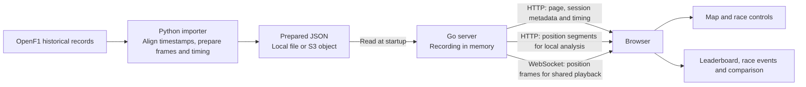

# F1 Race Replay project guide

## The project in one minute

F1 Race Replay is an interactive map and timing dashboard for a recorded Formula 1 race. A viewer can pause and compare how two drivers’ gaps changed around a pit stop, or join other viewers following the same replay clock. The main recording covers all 22 drivers in the 2026 Barcelona-Catalunya Grand Prix, from lights out through the last classified finisher. It runs for about 94 minutes.

**Milestone 1** proved the shared playback loop using a small synthetic recording. **Milestone 2** added the historical data pipeline, local and S3 recording sources, on-demand seeking, and the full race dashboard. A single Go process can synchronize its connected viewers. **Milestone 3** will address synchronization across server replicas.

Here’s a short way to introduce it in an interview:

> F1 Race Replay lets fans study a recorded race on their own or watch along on a shared clock. It prepares the archive once so viewers can jump straight to any moment. Position snapshots draw the map, and timing records drive the standings. Both use the same race time.

## User stories and checks

A user story names the viewer, their goal, and why it matters. The checks below make each story concrete during a demo. Use them to establish requirements before drawing the system. [Atlassian user stories guide](https://www.atlassian.com/agile/project-management/user-stories)

| Viewer goal | What counts as working |
| --- | --- |
| **Review a race decision.** As a fan studying a pit stop or Virtual Safety Car, I want to jump to the moment and compare two drivers so I can see how their races changed. | Pick an event and land on the first applicable frame. Seek back and see the earlier race state. Change either comparison driver while the playhead stays put. |
| **Follow the whole field.** As a viewer following a driver outside the lead battle, I want their position, gap, and tyre information so I can understand how they are doing. | All 22 drivers appear in the standings. Selecting one highlights their map marker when a position is available. A classified finisher’s flag appears at their own crossing. |
| **Watch together.** As a fan joining an ongoing replay, I want to arrive at the same race moment as the other viewers so we can discuss what is happening. | Two tabs on the same server advance on its clock. A late join or reconnect receives the current snapshot. A viewer in local analysis can seek independently. |

## Architecture and responsibilities



### Clocks and data ownership

- **Source time** is the UTC timestamp in the archive. The importer subtracts the race start so the position, lap, and race-control feeds share one reference.
- **Replay time** is the offset into the recording, represented by `elapsedMs`. It determines the car positions and what the viewer knows at that moment.
- **Playback time** is how the playhead advances. The local browser has its own clock, speed, and pause state. In shared playback, Go derives the current frame from how long it has been running. Go divides the time since startup by the recording’s frame interval (200 ms for Barcelona) to get a sequence number, then takes the remainder after dividing by the frame count to get the index inside the recording. The sequence keeps increasing across loops.

## From archive data to a recording

1. The importer downloads OpenF1 records and caches the raw responses so it can reuse them on later runs. It uses the race start from race control and joins feeds by driver ID. IDs are strings in the recording so a value such as `"01"` keeps its leading zero.
2. Location observations arrive at uneven times. Sort by timestamp, collapse identical duplicates, and reject conflicting observations at the same instant. Generate a frame every 200 ms. For a tick between samples no more than one second apart, estimate the coordinate along the line between them. If the gap is longer or the tick is outside the observations, omit the car from that frame. This bounds how much movement we infer from missing data.
3. Use the same scale, offset, and vertical-axis flip for the circuit outline and every car. The outline comes from Russell’s lap 40. The two timing-sector boundaries are estimated by adding the reference lap’s sector durations to its start and matching the nearest usable position samples. The browser rotates and fits this map and uses the same projection for drawing and detecting clicks.
4. Keep **timing records** separate from **position frames**. Timing arrives at a different cadence and has its own timestamps. Location can place two cars on the same straight while the timing feed says one is a lap down. The earliest recorded start across the field defines each race lap jump. [OpenF1 lap and location data](https://openf1.org/docs/#laps) · [OpenF1 timing data](https://openf1.org/docs/#intervals)

| Part of the recording | Example and purpose |
| --- | --- |
| **Session metadata** | Circuit outline, sector indices, driver IDs, duration, frame interval, race lap starts, and race-control transitions. It gives the browser enough to set up the map and controls. |
| **Position frames** | A frame is an array of car positions such as `{ "driver": "44", "x": 490.03, "y": 219.19 }`. The frame’s array index determines its time, so a timestamp on every car would repeat the same information. |
| **Timing history** | Separate timestamped lists per driver for running position, gap to leader, interval to the previous car, and laps. Tyre stints use lap ranges. A finish record carries its own timestamp. |

## From Go to the browser

Go can read the bundled synthetic demo, a prepared local file, or an `s3://bucket/key` object. It reads and decodes one recording before it starts listening. The server then reads that in-memory recording for all viewers. We exercised the S3 SDK path by uploading the two-driver Barcelona recording to **Moto**, a local S3 emulator. The full-grid replay runs from a generated local file.

| Request | What happens |
| --- | --- |
| **HTTP `GET /` and assets** | Loads the page, CSS, and JavaScript, which are embedded in the Go program. |
| **HTTP `GET /api/session`** | Loads geometry, the driver list, race-control markers, lap jumps, and playback settings. Both modes start here. |
| **HTTP `GET /api/segments/{index}`** | Local analysis requests a block of position frames. For the full grid, a block contains up to 100 frames, or 20 seconds. It includes the absolute index of its first frame. |
| **WebSocket `/ws`** | Shared playback starts with an HTTP upgrade and keeps the connection open. Go sends the current frame immediately, then pushes full snapshots on the server’s clock. Each message includes `sequence`, `elapsedMs`, and `positions`. |
| **HTTP `GET /api/timing`** | After the first map frame, the full-grid viewer requests the detailed timing history. Go encodes it once and can serve a gzip version to browsers that accept it. |

Local analysis uses HTTP to request the exact segment it needs. Shared playback uses a persistent connection so the server can push changing positions. Server-Sent Events could also carry a one-way stream. WebSockets leave room for two-way controls in a future version.

The browser keeps up to five segments, shares requests for the same in-flight segment, and prefetches near a segment boundary. A failed segment pauses local playback and can be retried. Detailed timing can fail independently of the map. A dropped WebSocket reconnects and resumes at the server’s current time.

## Trace one moment without opening the code

Pick the first **Virtual Safety Car deployed** entry in Race events:

The event is about **55:35** into the race. The browser rounds its timestamp up to the next 200 ms frame and uses that frame’s index to request **segment 166** if needed. Go returns the segment’s starting index so the browser can pick the right frame. The map draws the positions and the race-state banner finds the most recent transition at that time. Seek backward before deployment to see **Green flag** again. A seek and a late join both render directly from a timestamp.

### What the dashboard derives

| Feature | Rule at the current playhead |
| --- | --- |
| **Leaderboard** | Use the latest recorded running position. Gap is relative to the leader, interval is relative to the car ahead, and a lap deficit is shown as a lap count. Gap and interval samples expire after 15 seconds. |
| **Tyres and lap times** | Find the stint whose lap range contains the driver’s current lap. Tyre age is the age at the start of the stint plus laps run in that stint. Last and fastest lap times only consider laps whose estimated completion time has passed. |
| **Checkered flag and classification** | Match each classified finisher’s final lap to its start and duration. Show their flag at that crossing, including for lapped finishers. Use official order and gaps at the final frame, when any classification changes apply. Barcelona’s retirement labels appear at classification because the archive provides final outcomes with incomplete retirement timestamps. |
| **Map selection and comparison** | The viewer owns the selected car, so a click, driver picker, and leaderboard stay synchronized. The selected pair for the chart is independent and uses timing already loaded in the browser. |

## Reading the code in order

1. **`import_grid` and `resample`** build the recording. Start with the high-level importer, then follow one position observation into a frame. [Full-grid importer](tools/import_barcelona_grid.py) · [Resampler](tools/import_barcelona.py)
2. **`readRecording`, `replayRoutes`, and `frameAt`** load the data, register handlers, and turn elapsed time into a frame. Follow the WebSocket loop to see how every connection uses the same process start time. [Server](main.go) · [Types and frame lookup](replay.go) · [WebSocket loop](stream.go) · [S3 loader](s3.go)
3. **`showAt` and `showFrame`** turn a local seek into a segment request and then update the UI. Shared mode feeds the same render function through WebSocket. [Local analysis](web/analysis.js) · [Viewer](web/viewer.js)
4. Follow one view after `showFrame`. The map projects coordinates, the race banner looks up transitions, the tower reads driver timing, and the comparison calculates the two selected drivers’ results. [Map](web/circuit-map.js) · [Race state](web/race-context.js) · [Timing tower](web/timing-tower.js) · [Comparison and events](web/race-review.js)

## Practice for three kinds of interview questions

Use the same project in three ways. In a **project deep dive**, explain a decision you can trace and verify. In **system design**, ask what the product needs to support, propose a baseline, and follow the biggest trade-off. In a **behavioral interview**, use STAR (Situation, Task, Action, Result) and describe your own role and evidence. [Microsoft technical interviewing](https://careers.microsoft.com/v2/global/en/hiring-tips/technical-interviewing.html) · [Amazon SDE interview prep](https://amazon.jobs/content/en/how-we-hire/sde-ii-interview-prep?es_id=365f5ed5f2) · [Hello Interview design framework](https://www.hellointerview.com/learn/system-design/in-a-hurry/delivery)

### Project deep dive — practice these follow-ups aloud

| Opening question | Answer in your own words | Follow-up to be ready for |
| --- | --- | --- |
| **Why prepare frames offline?** | Align and interpolate the archive once. Fixed intervals give direct array lookup and avoid recomputing the map for every viewer. The trade-off is a larger generated file and the need to regenerate after importer changes. | **What if the archive has a gap?** The importer interpolates between observations at most a second apart. Across a longer gap, the frame omits that driver. |
| **What makes a seek correct?** | The browser locates the segment for the selected time. The same frame time drives the map, standings, and race state. | **What if an older seek response comes back last?** Each seek increments a generation counter. The browser checks it after awaiting the segment and discards outdated results. To test it directly, delay the first response, complete the second, and assert that the final playhead and car positions still reflect the second. |
| **How did you keep startup responsive?** | The full-grid file is about 24 MB. Metadata and the first position segment total about 100 KB. Detailed timing arrives after the map has a frame, at about 400 KB with gzip. The trade-off is that the standings can appear a little later. | **Why 20-second segments?** Shorter segments reduce how much data you need for a cold seek. Longer ones reduce requests during continuous playback. To evaluate a different size, measure first-frame time, seek latency, and requests per minute. |
| **Why use full WebSocket frames?** | A late joiner or reconnecting viewer can render immediately from one snapshot. If the send loop falls behind, it picks the current frame. | **Would deltas help?** They can reduce repeated coordinates, but then the client needs a baseline and a way to recover after skipping updates. |
| **How do you know the leaderboard is right?** | The location feed draws the map. Recorded race order and gaps provide standings. A car can be physically ahead on the circuit while a lap down. | **Can every finish be timed accurately?** Classified finishers get an estimated crossing from their recorded final lap. Retirement labels appear with the final classification because the archive’s retirement timestamps are incomplete. |

### System design — change one constraint

Practice this prompt aloud: **“Design this replay for multiple server replicas and 200 concurrent shared viewers.”**

1. **Clarify the requirement.** Can users pause the shared replay or only watch it? How far apart can two viewers be? Should the shared timeline survive a restart? Is 200 viewers the total or per race? Pick explicit assumptions with the interviewer.
2. **Draw the current design first.** Keep the prepared recording, HTTP segment requests, and WebSocket snapshots. Identify the break at two replicas. The same recording supplies the same frames, but each Go process currently picks them using its own start time.
3. **Propose the smallest change.** Agree on a race ID, recording version, and shared playback start time. Each replica can compute the frame locally using that reference. Explain what happens if a replica joins late, has a skewed clock, or loses access to shared state. If viewers can control shared playback later, also discuss who can update it and how updates are ordered.
4. **Estimate and verify.** At five frames per second, 200 viewers means about 1,000 outbound snapshots per second before reconnects or skipped frames. Multiply by measured frame bytes to estimate bandwidth. Measure two viewers’ playhead difference across replicas, first-frame latency, and reconnect behavior. These are design exercises for Milestone 3.

### Behavioral — prepare two STAR stories you can substantiate

Use the evidence below and fill in the **Action** with what you did personally: the requirement you identified, the decision you made, the code you worked on, or the way you verified the result. Describe Codex’s implementation help accurately when discussing your role. Use project outcomes and checks as evidence. [Amazon STAR guidance](https://amazon.jobs/content/en-gb/faq/interview-prep)

| Prompt | Situation and task | Action to put in your own words | Result you can verify |
| --- | --- | --- | --- |
| **Tell me about a time you changed the scope after seeing an initial implementation.** | The first historical replay centered on Hamilton and Russell. Studying the race also meant seeing the whole field and following individual finishes. | Explain what you noticed, how you described the full-grid experience, and which behavior you checked. Expect “What did you prioritize and why?” | The dashboard expanded to 22 drivers. Real-race checks confirmed separate crossing flags, lapped finishers, and the final order. [Full-grid change](https://github.com/auscodes/f1-race-replay/pull/8) |
| **Tell me about a trade-off you made for performance.** | A 50-second clip grew into a full race. The question became how much data the viewer needed before showing the first frame. | Explain what you wanted to protect, why the map and timing could load separately, and which measurement you can interpret. Expect “How would you choose the segment size?” | The first metadata and position responses totaled about 100 KB for a roughly 24 MB recording. The timing response was fetched separately. [Full-grid delivery change](https://github.com/auscodes/f1-race-replay/pull/8) |

### A 25-minute practice session

- **5 minutes:** Give the project pitch from memory. Name one user, one action, and the outcome it enables. Draw the three boxes for importer, Go server, and browser. Trace which clock each playback mode uses.
- **10 minutes:** Demo the VSC jump and step through one deep-dive answer. Have someone interrupt with a failure case. If you get stuck, open just the linked code for that path, then explain it again without looking.
- **10 minutes:** Answer the replica design prompt and one STAR prompt aloud. Check that each answer includes a concrete decision, its downside, and evidence or a test. Separate what shipped from what you would build next.

## Verification and a five-minute demo

| Layer | What it proves |
| --- | --- |
| **Importer tests** | Timestamp alignment, interpolation gaps, duplicate handling, sector boundaries, lapped finishers, and race-control transitions. [Importer tests](tools/test_import_barcelona.py) · [Full-grid tests](tools/test_import_barcelona_grid.py) |
| **Go tests** | Frame selection and wraparound, malformed data, file and S3 reads, segment bounds, compressed timing, and WebSocket joins. The S3 test uses a signed request against a local test endpoint. [Replay tests](replay_test.go) · [S3 tests](s3_test.go) · [Route tests](routes_test.go) · [Segment tests](segments_test.go) · [Stream tests](stream_test.go) |
| **Playwright and CI** | Browser flows for seeking, comparing drivers, highlighting cars, and reconnecting. CI runs Go formatting and vet checks, the Go tests with the race detector, importer tests, and Chromium tests. The real Barcelona recording was also checked on desktop and mobile. [Browser tests](tests/browser) · [CI](.github/workflows/ci.yml) |

Start the bundled 12-second demo from the repository root with `go run .`. For the full race, use Python 3.9 or newer and access to the OpenF1 archive:

```sh
python3 tools/import_barcelona_grid.py
go run . -recording .recordings/barcelona-2026-grid.json
```

Open [the local viewer](http://127.0.0.1:8080/), show the VSC jump and a backward seek, then switch drivers in the comparison. In the Network tab, point out `/api/session`, a position segment request, and `/api/timing`. Switch to shared playback in two tabs and show how `/ws` gives both tabs the same race time. Use a seek to show local analysis moving independently. For optional S3 setup and the full list of development commands, see the [README](README.md).
