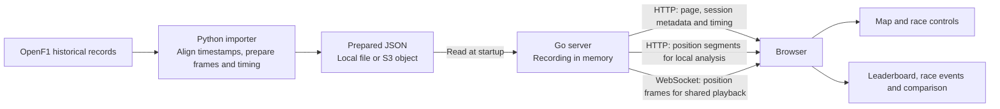

# F1 Race Replay project guide

## The project in one minute

F1 Race Replay is an interactive map and timing dashboard for a recorded Formula 1 race. A viewer can pause and compare how two drivers’ gaps changed around a pit stop, or join other viewers following the same replay clock. The main recording covers all 22 drivers in the 2026 Barcelona-Catalunya Grand Prix, from lights out through the last classified finisher. It runs for about 94 minutes.

**Milestone 1** proved the shared playback loop using a small synthetic recording. **Milestone 2** added the historical data pipeline, local and S3 recording sources, on-demand seeking, and the full race dashboard. A single Go process can synchronize its connected viewers. **Milestone 3** will address synchronization across server replicas.

Here’s a short way to introduce it in an interview:

> I built a historical F1 replay with two viewing modes. One lets you study a race on your own. The other keeps viewers on a shared server clock. I prepared the location and timing data once so the viewer can jump straight to any moment. The main design decision was to use position snapshots for the map and separate timing records for the standings, with both keyed to the same race time.

## Architecture and responsibilities



| Technology | What you need to explain |
| --- | --- |
| **Python** | Runs offline to download, normalize, and join data. A generated recording can replay independently of the archive. |
| **Go and `net/http`** | Load one recording at startup and serve the page, JSON endpoints, and WebSocket. Each connected viewer has a send loop. |
| **JSON and S3** | JSON is the contract between Python, Go, and the browser. S3 is an optional way to store and retrieve the prepared file by bucket and key. |
| **JavaScript and Canvas** | JavaScript owns the local playhead, looks up timing, and updates the interface. Canvas draws all the cars on one circuit. |

### Clocks and data ownership

- **Source time** is the UTC timestamp in the archive. The importer subtracts the race start so the position, lap, and race-control feeds share one reference.
- **Replay time** is the offset into the recording, represented by `elapsedMs`. It determines the car positions and what the viewer knows at that moment.
- **Playback time** is how the playhead advances. The local browser has its own clock, speed, and pause state. In shared playback, Go derives the current frame from how long it has been running. Go divides the time since startup by the recording’s frame interval (200 ms for Barcelona) to get a sequence number, then takes the remainder after dividing by the frame count to get the index inside the recording. The sequence keeps increasing across loops.

## From archive data to a recording

1. The importer downloads OpenF1 records and caches the raw responses so it can reuse them on later runs. It uses the race start from race control and joins feeds by driver ID. IDs are strings in the recording so a value such as `"01"` keeps its leading zero.
2. Location observations arrive at uneven times. Sort by timestamp, collapse identical duplicates, and reject conflicting observations at the same instant. Generate a frame every 200 ms. For a tick between samples no more than one second apart, estimate the coordinate along the line between them. If the gap is longer or the tick is outside the observations, omit the car from that frame. This bounds how much movement we infer from missing data.
3. Use the same scale, offset, and vertical-axis flip for the circuit outline and every car. The outline comes from Russell’s lap 40. The two timing-sector boundaries are estimated by adding the reference lap’s sector durations to its start and matching the nearest usable position samples. The browser rotates and fits this map and uses the same projection for drawing and detecting clicks.
4. Keep **timing records** separate from **position frames**. Timing arrives at a different cadence and has its own timestamps. Location can place two cars on the same straight while the timing feed says one is a lap down. The earliest recorded start across the field defines each race lap jump. [OpenF1 lap and location data](https://openf1.org/docs/#laps) · [OpenF1 timing data](https://openf1.org/docs/#intervals)

| Part of the recording | Example and purpose |
| --- | --- |
| **Session metadata** | Circuit outline, sector indices, driver IDs, duration, frame interval, race lap starts, and race-control transitions. It gives the browser enough to set up the map and controls. |
| **Position frames** | A frame is an array of car positions such as `{ "driver": "44", "x": 490.03, "y": 219.19 }`. The frame’s array index determines its time, so a timestamp on every car would repeat the same information. |
| **Timing history** | Separate timestamped lists per driver for running position, gap to leader, interval to the previous car, and laps. Tyre stints use lap ranges. A finish record carries its own timestamp. |

## From Go to the browser

Go can read the bundled synthetic demo, a prepared local file, or an `s3://bucket/key` object. It reads and decodes one recording before it starts listening. The server then reads that in-memory recording for all viewers. We exercised the S3 SDK path by uploading the two-driver Barcelona recording to **Moto**, a local S3 emulator. The full-grid replay runs from a generated local file.

| Request | What happens |
| --- | --- |
| **HTTP `GET /` and assets** | Loads the page, CSS, and JavaScript, which are embedded in the Go program. |
| **HTTP `GET /api/session`** | Loads geometry, the driver list, race-control markers, lap jumps, and playback settings. Both modes start here. |
| **HTTP `GET /api/segments/{index}`** | Local analysis requests a block of position frames. For the full grid, a block contains up to 100 frames, or 20 seconds. It includes the absolute index of its first frame. |
| **WebSocket `/ws`** | Shared playback starts with an HTTP upgrade and keeps the connection open. Go sends the current frame immediately, then pushes full snapshots on the server’s clock. Each message includes `sequence`, `elapsedMs`, and `positions`. |
| **HTTP `GET /api/timing`** | After the first map frame, the full-grid viewer requests the detailed timing history. Go encodes it once and can serve a gzip version to browsers that accept it. |

**Why these delivery methods?** Local analysis knows the exact time it wants, so it can request that segment directly and move the playhead independently. Shared playback needs the server to push the changing position to everyone following it. A WebSocket gives it a persistent connection. Server-Sent Events could also carry the one-way stream. WebSockets leave room for two-way controls in a future version.

**What happens on a slow connection?** The full-grid file is about 24 MB. Metadata plus the first position segment total about 100 KB. The separate timing response is about 400 KB with gzip. In local analysis the browser keeps up to five segments, reuses an in-flight request for the same segment, and prefetches the next one near the boundary. After a quick series of seeks, only the latest request can update the displayed frame. During shared playback Go reads the current frame on every send, so a slow connection can skip older snapshots and catch up.

## Trace one moment without opening the code

Pick the first **Virtual Safety Car deployed** entry in Race events:

1. The event is at **3,335,146 ms** after lights out. The browser rounds up to **3,335,200 ms**, the first frame at or after the event.
2. Divide that time by 200 ms to get **frame 16,676**. With 100 frames per segment, request **segment 166** if it is absent from the cache. Read frame **76** within that segment. Segment and frame offsets start at zero.
3. The viewer sends the car positions to Canvas and passes the same frame time to the timing tower, map details, race-state banner, and lap comparison.
4. The race-state lookup finds the latest transition at or before that time and displays **Virtual Safety Car**. A backward seek before deployment selects the previous **Green flag** state. The ending warning and the track-wide clear message take effect at their own recorded times.

The key here is that a seek, a late join, and ordinary playback can all render from a timestamp. Each view can arrive at the same answer even if it skipped earlier frames.

### What the dashboard derives

| Feature | Rule at the current playhead |
| --- | --- |
| **Leaderboard** | Use the latest recorded running position. Gap is relative to the leader, interval is relative to the car ahead, and a lap deficit is shown as a lap count. Gap and interval samples expire after 15 seconds. |
| **Tyres and lap times** | Find the stint whose lap range contains the driver’s current lap. Tyre age is the age at the start of the stint plus laps run in that stint. Last and fastest lap times only consider laps whose estimated completion time has passed. |
| **Checkered flag and classification** | Match each classified finisher’s final lap to its start and duration. Show their flag at that crossing, including for lapped finishers. Use official order and gaps at the final frame, when any classification changes apply. Barcelona’s retirement labels appear at classification because the archive provides final outcomes with incomplete retirement timestamps. |
| **Map selection and comparison** | The viewer owns the selected car, so a click, driver picker, and leaderboard stay synchronized. The selected pair for the chart is independent and uses timing already loaded in the browser. |

## Reading the code in order

1. **`import_grid` and `resample`** build the recording. Start with the high-level importer, then follow one position observation into a frame. [Full-grid importer](tools/import_barcelona_grid.py) · [Resampler](tools/import_barcelona.py)
2. **`readRecording`, `replayRoutes`, and `frameAt`** load the data, register handlers, and turn elapsed time into a frame. Follow the WebSocket loop to see how every connection uses the same process start time. [Server](main.go) · [Types and frame lookup](replay.go) · [WebSocket loop](stream.go) · [S3 loader](s3.go)
3. **`showAt` and `showFrame`** turn a local seek into a segment request and then update the UI. Shared mode feeds the same render function through WebSocket. [Local analysis](web/analysis.js) · [Viewer](web/viewer.js)
4. Follow one view after `showFrame`. The map projects coordinates, the race banner looks up transitions, the tower reads driver timing, and the comparison calculates the two selected drivers’ results. [Map](web/circuit-map.js) · [Race state](web/race-context.js) · [Timing tower](web/timing-tower.js) · [Comparison and events](web/race-review.js)

## Defend the design in an interview

| Question | What a good answer covers |
| --- | --- |
| **Why prepare frames offline?** | It moves uneven-sample processing and interpolation off the playback path. Fixed 200 ms steps give direct array lookup. The cost is a larger prepared file, and a change to the import logic requires regeneration. |
| **Why use JSON and an in-memory recording?** | An inspectable format and one file make local development and testing straightforward. The server avoids disk or S3 reads on each seek. Memory and cold-start work grow with recording size, so a larger race library would motivate independently stored segments and selective loading. |
| **Why send full WebSocket snapshots?** | Every frame is independently usable when a viewer joins or reconnects. Delta messages would save bytes at the cost of tracking a baseline and recovering when messages are skipped. At five sends per second, 200 viewers means about 1,000 outbound messages per second at full cadence. Use that estimate to plan a load test. |
| **What happens if things fail?** | Go exits at startup if it cannot load the requested recording. Local analysis pauses when a segment fails and lets the viewer retry. Timing can fail separately while the map still receives frames. A dropped socket reconnects and receives the current snapshot. |
| **Would two servers with the same S3 object stay synchronized?** | The object supplies the race data. Each process currently has its own playback start time, so independently started replicas can serve different frames. A shared start time or playback state is the next milestone. |
| **What limits the accuracy?** | The archive provides approximate car locations and lap starts. We estimate positions between nearby samples and use timing records for gaps and rank. The map is suitable for following race progress and comparing timing. |

## Verification and a five-minute demo

| Layer | What it proves |
| --- | --- |
| **Importer tests** | Timestamp alignment, interpolation gaps, duplicate handling, sector boundaries, lapped finishers, and race-control transitions. [Importer tests](tools/test_import_barcelona.py) · [Full-grid tests](tools/test_import_barcelona_grid.py) |
| **Go tests** | Frame selection and wraparound, malformed data, file and S3 reads, segment bounds, compressed timing, and WebSocket joins. The S3 test uses a signed request against a local test endpoint. [Replay tests](replay_test.go) · [S3 tests](s3_test.go) · [Route tests](routes_test.go) · [Segment tests](segments_test.go) · [Stream tests](stream_test.go) |
| **Playwright and CI** | Browser flows for seeking, comparing drivers, highlighting cars, and reconnecting. CI runs Go formatting and vet checks, the Go tests with the race detector, importer tests, and Chromium tests. The real Barcelona recording was also checked on desktop and mobile. [Browser tests](tests/browser) · [CI](.github/workflows/ci.yml) |

Start the bundled 12-second demo from the repository root with `go run .`. For the full race, use Python 3.9 or newer and access to the OpenF1 archive:

```sh
python3 tools/import_barcelona_grid.py
go run . -recording .recordings/barcelona-2026-grid.json
```

Open [the local viewer](http://127.0.0.1:8080/), show the VSC jump and a backward seek, then switch drivers in the comparison. In the Network tab, point out `/api/session`, a position segment request, and `/api/timing`. Switch to shared playback in two tabs and show how `/ws` gives both tabs the same race time. Use a seek to show local analysis moving independently. For optional S3 setup and the full list of development commands, see the [README](README.md).
