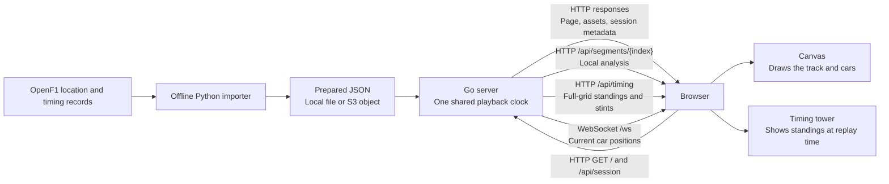

# F1 Race Replay project guide

F1 Race Replay lets people study a race by replaying car positions on a track map. The full Barcelona recording follows all 22 drivers from lights out through the last classified finisher, about 94 minutes. A 50-second clip around Hamilton's final pit stop remains available for quick checks. [Formula 1 race report](https://www.formula1.com/en/latest/article/hamilton-claims-stellar-maiden-grand-prix-victory-for-ferrari-in-barcelona-as-antonelli-suffers-shock-retirement.4yCXiPLHUdcnl2BwNpqUIa)

## Architecture

### When HTTP and WebSocket come in

1. **Load the page over HTTP.** The browser requests `GET /` for the HTML, then fetches its JavaScript and CSS with separate HTTP requests.
2. **Fetch the map over HTTP.** The JavaScript calls `GET /api/session` once on page load. Go returns a JSON response containing the circuit outline, driver IDs, and clip duration.
3. **Open the position stream.** The browser connects to `/ws`. In this app, that starts as an HTTP/1.1 upgrade request. Go replies with `101 Switching Protocols` and the connection stays open as a WebSocket. The server sends the current frame immediately, then sends a new snapshot every 200 ms during steady playback.

HTTP request and response fit the page and map because the browser needs them once. A WebSocket lets the server push changing positions over one open connection. Polling could do the job with repeated requests. Server-Sent Events (SSE) could also carry this one-way stream. WebSockets support messages in both directions if shared playback controls are added later.

**Local analysis** starts paused and fetches the first position segment over HTTP. Segments cover 20 seconds for the full grid and one minute for the two-driver recording. Seeking requests the segment for the selected time. The browser keeps up to five segments and prefetches the next one near a boundary. The local clock controls play, pause, and speed. **Shared playback** uses the server clock and the WebSocket.

The prepared full-grid file is about 24 MB. The metadata and first position segment total about 100 KB. The session metadata includes the small race-state timeline and race distance. The browser requests the complete driver timing history after the first position frame. Go compresses that separate response to about 400 KB for browsers that support gzip.

To see the difference, open the browser's Network tab and reload. Inspect the JSON response from `/api/session`, then inspect `/api/segments/0` and `/api/timing`. Switch to shared playback to watch messages arrive over `/ws`.

## Technologies to know

| Technology | What to understand |
| --- | --- |
| **Python and OpenF1** | The importer turns uneven position samples into regular frames once, before anyone opens the viewer. The generated clip can be replayed without calling OpenF1. |
| **Amazon S3** | An object is a stored recording identified by a bucket and key. Go fetches it once at startup. The server then serves frames from memory. |
| **Go and `net/http`** | A route maps to a handler. Each WebSocket connection has its own send loop, timer, and write timeout. Learn how handlers share the recording and start time while each manages its own connection. |
| **HTTP and WebSocket** | Be able to explain the page request, the metadata response, the upgrade, and what happens when a socket disconnects. |
| **JSON, JavaScript, and Canvas** | JSON is the data format both sides agree on. JavaScript parses each frame and draws a dot at each driver's `x` and `y` on the canvas. |

## Data model and decisions

| Model | What it stores and why |
| --- | --- |
| **Session metadata** | Circuit name, outline, driver IDs, and clip duration. Historical clips also carry driver names and source details, including the original UTC start time. The browser fetches metadata once. |
| **Recording** | An interval and an array of position snapshots. The snapshots are 200 ms apart, so Go can look up a row by dividing elapsed time by the interval. The small demo file is loaded into memory at startup. |
| **Stream frame** | `sequence` counts intervals since the process started. `elapsedMs` is the time within the clip and wraps at the end. `positions` contains each driver's ID and map coordinates. Driver IDs are strings, so `"01"` keeps its leading zero. |

One server clock means late joiners receive the current frame as soon as they connect. Sending **full snapshots** means any one message is enough to draw the cars, even after a skipped update. The trade-off is repeating every available car position in each message. Smaller change-only messages would require an initial snapshot and a way to recover missed changes.

### How historical samples become frames

- **Align on source timestamps.** All cars use the same UTC ticks, 200 ms apart. We sort their samples, collapse identical duplicates, and reject conflicting positions at the same timestamp.
- **Use nearby observations.** If a frame falls between two samples at most one second apart, estimate the position between them. Across a longer gap or beyond the available data, leave that driver's position out of the frame. The Barcelona source gave both drivers positions in all 250 frames.
- **Use one map transform.** Russell's lap 40 gives the main circuit outline. The track and all cars get the same scale, offset, and vertical-axis flip. The outline approximates a driven lap. Pit-lane positions can appear beside it, and the source coordinates only support an approximate view of each car's progress. [OpenF1 location data](https://openf1.org/docs/#location)
- **Keep race events separate from frames.** Lap changes, timing, pit stops, and VSC messages use the same elapsed clock as the positions. The two drivers can be on different laps at the same instant. Gaps come from the timing feed and expire after 15 seconds without an update. Barcelona has 28,135 full-grid frames. Timing records are stored separately because they update less often and have their own timestamps. [OpenF1 timing data](https://openf1.org/docs/#intervals)
- **Show results at the point they become known.** A lap time enters the comparison at the lap's estimated finish, so seeking backwards also rolls back the fastest-lap value. The chart shows zero while the position feed records a driver in the lead. Elsewhere it leaves breaks where numeric gap samples are unavailable or more than 15 seconds apart. The event list shows pit-lane time and stationary stop time separately. [OpenF1 lap and pit data](https://openf1.org/docs/#laps)

### How the leaderboard works

- **Race order and gaps come from timing records.** Track coordinates draw the map. They cannot tell you how many laps a car has completed. The tower finds the most recent timing sample at or before the playhead. A gap is measured against the leader, while an interval is measured against the car ahead. The archive also reports lap deficits, such as `+1 lap`. [OpenF1 positions and intervals](https://openf1.org/docs/#intervals)
- **Tyre age comes from the stint.** Match the driver's current lap to the stint's lap range. Add the laps run during the stint to the age reported when it began. The number is the age at the start of that lap. [OpenF1 stints](https://openf1.org/docs/#stints)
- **A finish is per driver.** The importer matches a classified finisher's final lap to its start time and duration, then checks that the crossing falls after the race control flag. Even lapped drivers get their own finish time. At the final frame the tower switches to the official order and gaps, which can reflect penalties. Barcelona's archived results identify retirements without reliable timestamps for each car, so the tower shows those DNF labels with the final classification. Seeking backwards rolls back the results. [OpenF1 session results](https://openf1.org/docs/#session-result)

### How race state and driver comparison follow a seek

- **Race control is a timeline of changes.** The importer records the start, Virtual Safety Car deployment, the ending warning, the track-wide clear message, and the chequered flag. The viewer finds the most recent change at or before the current playhead. That works for backward seeks, late joins, and frames skipped during buffering. A clear signal for one sector doesn't end a track-wide Virtual Safety Car.
- **The lap counter follows first place.** Find the driver in P1 at the playhead, then read that driver's latest lap. The race distance is the official winner's completed lap count. The lookup uses the same timestamps as the leaderboard.
- **Driver selection stays in the browser.** Every driver's timing is already in the archive response. Changing either dropdown rebuilds the two chart series and recalculates last and fastest completed laps at the same playhead. The comparison and the local playback clock are independent.

## Where to look in the code

| Start here | What it does |
| --- | --- |
| [tools/import_barcelona_grid.py](tools/import_barcelona_grid.py) | Downloads and caches the full-grid archive, joins timing records by driver, and computes finish times. |
| [tools/import_barcelona.py](tools/import_barcelona.py) | Aligns location samples and transforms them into map frames. Also generates the two-driver recordings. |
| [testdata/demo.json](testdata/demo.json) | Stores the synthetic track and 60 sets of car positions. |
| [main.go](main.go) | Chooses the bundled demo, a local file, or S3. Starts the clock after reading the recording. |
| [s3.go](s3.go) | Uses the AWS SDK to read the prepared JSON from S3. |
| [replay.go](replay.go) | Defines the data types and uses `frameAt` to select a row in the clip. |
| [stream.go](stream.go) | Upgrades the connection, sends frames, and skips ahead if a write falls behind. |
| [web/viewer.js](web/viewer.js) | Fetches the session, opens the socket, and calls `ctx.arc` to place each car. |
| [web/analysis.js](web/analysis.js) | Handles the local clock, segment requests, and lap and event jumps. |
| [web/timing-tower.js](web/timing-tower.js) | Picks timing records by replay time and renders rank, gaps, tyres, lap times, and flags. |
| [web/race-context.js](web/race-context.js) | Finds the race-control state, leader and lap for the current frame. |
| [web/race-review.js](web/race-review.js) | Updates the selected pair’s gap chart and completed laps and connects event buttons to local seeking. |

## Trace one frame

At **0:28.2** in the short Barcelona clip, the importer uses source time **14:01:36.200 UTC**. Hamilton's surrounding observations are at **14:01:36.171** and **14:01:36.411**. The importer estimates his position between them, transforms it onto the map, and writes it to frame index **141**. In the full race, that same moment is around **58:08** because the recording starts at lights out. The source clock gives both recordings a common reference point.

## How we verify changes

| Test layer | What it checks |
| --- | --- |
| **Unit** | Replay timing at startup and loop boundaries, a one-frame recording, and rejection of malformed or incomplete recordings. [Replay tests](replay_test.go) |
| **Importer** | UTC alignment, duplicate samples, exact matches, gaps, and a shared coordinate transform. CI uses synthetic inputs, including lapped finishers and retirements. [Importer tests](tools/test_import_barcelona.py) · [Classification tests](tools/test_import_barcelona_grid.py) |
| **Integration** | File loading, a signed S3 request against a local endpoint, HTTP session metadata, and advancing frames on a real WebSocket. [File tests](main_test.go) · [S3 tests](s3_test.go) · [Route tests](routes_test.go) · [WebSocket tests](stream_test.go) |
| **Browser** | Playwright starts the Go app and checks that the inspector can freeze and resume, playback continues after reconnect, and a failed metadata request shows an error. The grid test checks that race state and finish flags roll back when seeking, and that changing the selected pair keeps the same playhead. [Grid test](tests/browser/grid.spec.mjs) [Browser tests](tests/browser/replay.spec.mjs) |

GitHub Actions runs these checks on pull requests. The real Barcelona clip is generated locally. The S3 test uses a local endpoint with test credentials.

## Think like a system designer

- **Where does the authoritative state live?** The prepared recording contains historical positions. The running Go process owns the playback clock. Two servers reading the same S3 object can still disagree about the current frame if they started at different times.
- **How does the client recover?** After a disconnect, the browser retries and can draw the first full frame it gets. If the process itself restarts, it starts a new timeline because the old start time lived in memory.
- **What grows with more viewers?** At five frames per second, 200 connected viewers would mean about 1,000 outbound messages per second at full cadence. That's a rough estimate for a future load test. Measure message size and watch CPU and network use to see what actually limits the app.

**Storage verification.** The two-driver full race was uploaded to Moto on localhost and loaded through the same S3 SDK path that Go uses for a bucket. The browser replayed from that object. **Next milestone.** Share one playback timeline across multiple servers using Redis.

Update this guide when a milestone ships. Revise the flow and file list in place, and keep the decisions and limits that still apply.
