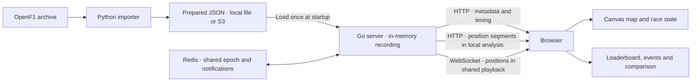

# F1 Race Replay — Interview answers

[All milestones and verification status](docs/ROADMAP.md) · [Redis and shared playback architecture](docs/REDIS_CLOCK.md) · [Kubernetes, metrics and load testing](docs/DEPLOYMENT.md)

## Start here if the stack is new to you

Read the [beginner stack guide](docs/STACK_GUIDE.md) first. It follows one frame from the S3 SDK through Go, Redis, and WebSockets, then follows one viewer through Kubernetes scaling and a pod failure. It gives you an interview answer for each résumé bullet and points to the implementation and evidence. Use the questions below for deeper follow-ups.

## “Tell me about your project.”

> I built an interactive replay of the 2026 Barcelona Formula 1 race. It covers all 22 drivers over about 94 minutes. You can jump to a pit stop, follow a driver on the map, and compare lap times or gaps. There’s also a shared mode where viewers connected to the same server follow the same replay clock. The main engineering challenge was turning separate historical feeds into a replay you can seek through quickly while keeping the map, standings, and race events aligned.

## “Walk me through it end to end.”

> The original version proved that a Go server could stream a small synthetic replay. In Milestone 2, I expanded it into a full historical race. A Python importer pulls locations, lap timing, standings, tyres, and race control from OpenF1. It converts everything to milliseconds since lights out. It samples positions onto a 200-millisecond grid and saves those frames alongside separate timing records in a prepared JSON file.
>
> Go loads the recording once when it starts. It can read a local file or retrieve an object through the S3 SDK. The browser first gets the circuit, drivers, and basic race metadata over HTTP. For personal analysis, it requests the 20-second block of positions that contains the selected moment. For shared playback, Go sends the current frame over a WebSocket and advances it using the server’s clock. Both modes hand the same kind of frame to the browser’s renderer.
>
> The browser draws the cars on Canvas, then uses that frame’s timestamp to update the leaderboard, driver comparison, and race-control banner. We fetch the detailed timing history after the first map frame so the viewer can see the replay sooner. Milestone 3 added a Redis clock so multiple Go replicas can agree on the current frame. Each replica still streams to its own viewers.

## “Who is this for, and what did you personally do?”

### “What are the main user stories?”

> There are three. One viewer wants to investigate a specific race decision. Another wants to follow a driver anywhere in the field. A third wants to talk about the race with someone who’s watching at the same time.

Each answer below takes about three minutes at a conversational pace.

#### “Walk me through how someone would analyze a race decision.”

> Imagine I watched the Barcelona Grand Prix and wanted to understand what happened to Hamilton and Russell around a Virtual Safety Car. I might remember Hamilton coming into the pits, but the final result gives me very little context about what was happening just before the stop. The first user story is about being able to return to that moment and study it at my own pace.
>
> I’d open the replay in personal analysis mode, go to Race events, and select the first Virtual Safety Car deployment, about 55 minutes into the recording. The viewer takes me to that moment and brings me back to the circuit map. I can see which lap the race leader is on, where the cars are, and that the Virtual Safety Car is active. I can pause, seek backward to see the field before the deployment, or pick Hamilton’s pit stop to see when it happened. Where the archive includes the details, the event shows stationary time separately from time spent in the pit lane.
>
> Next I’d compare Hamilton and Russell. The chart shows each driver’s gap to the race leader, and the lap table shows their last and fastest completed laps at my playhead. I can switch either driver while staying at the same point in the race. That lets me look at a third driver’s race without losing the moment I was investigating. I’d use the chart to describe what changed around the stop. The timing also gives me a starting point for a question about strategy, since traffic, tyres, and the Virtual Safety Car can all affect those gaps.
>
> The key engineering decision was to make a jump behave as if I’d played the race up to that point. The browser requests the 20-second block containing the selected frame and uses that frame’s timestamp across the map, standings, and race-control banner. When I seek backward before deployment, the banner returns to green because it looks up the last transition at that time. That’s also the example I’d demo in an interview. One click takes me to the event, a backward seek rolls back the state, and changing the comparison pair keeps the playhead in place. [Local seek logic](web/analysis.js) · [Race-state lookup](web/race-context.js)

#### “Why did you expand it to the full field? What does a viewer get out of that?”

> The first historical version focused on Hamilton and Russell. That was a manageable starting point for getting real location and timing data to play back together. Once I saw the two-driver replay, I wanted to be able to follow a driver outside the main battle. If I’m interested in Norris, for example, I want to know who he’s racing around, how far ahead the next driver is, and what tyres he’s on. Those questions motivated the move to the full grid.
>
> In the Barcelona replay, I can pick Norris from the standings, the driver picker, or the circuit map. His marker gets a label, his row is highlighted, and I can see his position, gap, lap, tyres, and last lap when that information is available. The rest of the field stays visible, so I can see his race in context. I can switch the leaderboard from gap to the race leader to interval to the car ahead. Those answer different questions. One tells me how far he is from first place. The other helps me see how close his immediate battle is.
>
> The most important design choice was to separate the map from the timing feed. Think about a car that’s been lapped. It can be physically ahead of the race leader on the main straight while being behind in the standings. The map shows where the cars are. The leaderboard uses recorded timing to show race position and gaps, including a deficit reported in laps. The data also updates at different rates. If a gap goes stale, the viewer shows a dash until there’s a usable update.
>
> I also wanted a clear finish for each driver. At Barcelona, Hamilton and Russell crossed about 19 and a half seconds apart. Their checkered flags appear at their own crossings, and classified lapped finishers also get individual finish times. The final frame shows the official order. That gave me a concrete way to judge the full-grid change. A viewer could pick someone farther down the field, follow their race, and understand when their race ended. [Full-grid leaderboard](https://github.com/auscodes/f1-race-replay/pull/8) · [Map and driver selection](https://github.com/auscodes/f1-race-replay/pull/10)

#### “Why would anyone want synchronized playback of a race that already happened?”

> Imagine two friends reviewing a race they already know the result of. They’re trying to figure out what happened around a pit stop. One says, “Look at where Russell is now,” but if their replays started at different times, the other person could still be watching the previous lap. They both have the same recording. What they need is a shared reference for the moment they’re talking about.
>
> In shared playback, both friends can open the replay and follow the clock on the same Go server. If one arrives later, their browser gets the frame the server is showing at that moment. If their connection drops briefly, the replay can reconnect and pick up at the server’s current position in the race. This is why I kept personal analysis as a separate mode. When I’m studying a particular pit stop, I want control over pause, speed, and seeking. When I’m watching with someone else, I want “right now” to refer to the same part of the race for both of us.
>
> The implementation gives each WebSocket connection its own send loop, but the loops use the same server start time to figure out which frame to send. Each message contains a complete snapshot of the available car positions. A new viewer can draw the first frame they receive. The viewer also retries after three seconds without a frame, which covers sockets that stay open but stop delivering data. If a connection falls behind, the next send picks the current frame instead of queuing all the ones the viewer missed. That favors staying close to the conversation, with the trade-off that we send repeated coordinates and a slow viewer may skip some frames.
>
> The simplest demo uses two viewers on the same server. I’d open one shared tab, let it run, then open a second and show that it joins in progress. The limitation becomes clear if I start two Go servers at different times. They can have identical race files and still disagree about the live replay position because each owns its own clock. Milestone 3 solves that by letting both servers use the same Redis epoch. I can also show two independently started servers joining the same timeline. [Shared send loop](stream.go) · [Late-join tests](stream_test.go) · [Reconnect test](tests/browser/replay.spec.mjs)

### “What was your contribution? How did you use Codex?”

> I drove the scope and product decisions. I chose the Barcelona recording, started with Hamilton and Russell to keep the first version manageable, then asked for the full field, meaningful gaps, and finish indicators. I also asked how loading a full race would affect the viewer and chose to exercise the storage path locally. I used Codex for much of the implementation and worked through the design and code as the project evolved. I can explain how the importer prepares the data, how both playback modes choose a frame, and what the tests verify.

### “Tell me about a time your requirements changed.”

> The first historical replay focused on Hamilton and Russell. Once I saw it, I wanted to follow the entire field through the race. That meant seeing race position, gap, and when each driver actually finished. I asked for a full-grid leaderboard and individual finish flags, and I prioritized those because the map alone could show where a car was but couldn’t explain how it was doing.
>
> The result was a dashboard with all 22 drivers and separate crossing indicators. One concrete result was that Hamilton’s flag appeared at his crossing, and Russell’s appeared at his own crossing about 19.5 seconds later. The replay also accounts for classified finishers who were a lap down. [Full-grid change](https://github.com/auscodes/f1-race-replay/pull/8)

### “Tell me about a performance trade-off.”

> When the replay grew from a 50-second clip to a full race, I asked what the browser would need to download before it could show anything. The resulting design sends the circuit and the first block of positions first, then fetches detailed timing separately. The full-grid file is about 24 MB, while the metadata and first position block total about 100 KB. The trade-off is that the map can appear before the detailed standings. If I were tuning the segment size further, I’d measure first-frame latency, cold seek latency, and requests per minute together. [Full-grid delivery change](https://github.com/auscodes/f1-race-replay/pull/8)

### “What would you do differently?”

> I’d define the full-race navigation earlier. In the first version, the lap selector was tied to Hamilton because that was the pair we started with. Once the rest of the grid was available, I asked for a race lap selector and moved event navigation into the event list. I’d make race-level and driver-level concepts explicit from the start, then test a workflow where someone follows a driver outside the lead battle. [Map and navigation change](https://github.com/auscodes/f1-race-replay/pull/10)

## Data and correctness

### “Why prepare the data offline? What exactly is in the recording?”

> OpenF1 locations come at irregular times, and different feeds update independently. The importer aligns them once and writes fixed-rate position frames so playback can use a direct array lookup. The recording contains session metadata, position frames, and timing history. Metadata describes the circuit and drivers. Each frame is a list of driver IDs and coordinates. Timing is a set of timestamped records for each driver, plus race-wide events. The cost of preparing frames is a larger file and regenerating it when the importer logic changes. [Importer](tools/import_barcelona_grid.py) · [Recording types](replay.go)

### “How do you handle timestamps and missing locations?”

> Archive timestamps are in UTC. I subtract the race start to put all feeds on the same elapsed clock. The importer sorts observations and collapses identical duplicates. For a frame between two samples at most one second apart, it interpolates between their coordinates. Across a bigger gap or outside the observed range, the car is absent from that frame. The one-second bound keeps the map from drawing a car along a long guessed path. [Resampler](tools/import_barcelona.py)

### “Why can’t you rank the cars from the map?”

> Track location shows where a driver is on the circuit. Someone who is a lap down can be physically ahead of the leader on the same straight. I use recorded race order for rank, recorded gap for the difference to the leader, and recorded interval for the difference to the car ahead. I also expire gap and interval samples after 15 seconds so stale numbers don’t sit on the board indefinitely. [Driver timing lookup](web/timing-tower.js)

### “How do flags, tyres, and lap times update correctly after seeking?”

> Each view asks what was known at the selected timestamp. The race-state banner finds the last race-control transition. A Virtual Safety Car ending warning is its own state, and the track-wide clear message returns the race to green. For an individual checkered flag, the importer estimates the crossing from the driver’s final lap start and duration. The last frame shows the official classification, which can account for penalties. The archive has incomplete retirement timestamps, so those retirement labels appear with the final results.
>
> For tyres, the browser finds the stint covering the driver’s current lap, then adds the laps run in that stint to the starting tyre age. For the lap comparison, it uses laps completed by the playhead. That means a backward seek can roll back a fastest-lap value or a finish flag. [Race state](web/race-context.js) · [Classification importer](tools/import_barcelona_grid.py) · [Lap comparison](web/race-review.js)

### “What did you do to make the map interactive?”

> The importer uses Russell’s lap 40 for the outline and estimates the timing-sector boundaries by matching sector split times to nearby location samples. The browser uses the same coordinate projection for the track and the cars. When someone clicks the canvas, it compares the click with the projected car positions. The viewer holds one selected-driver ID, so the map, picker, and timing tower stay in sync. The sectors are approximate, and the map is meant to show race progress. [Circuit map](web/circuit-map.js) · [OpenF1 lap and location data](https://openf1.org/docs/#laps)

## Delivery, latency, and failure handling

### “Why HTTP for one mode and WebSockets for the other?”

> Both modes use HTTP for the page, metadata, and timing history. Personal analysis already knows which time it needs, so it requests that position segment directly over HTTP. Shared playback needs Go to push changing positions to all the viewers following its clock. A WebSocket starts with an HTTP upgrade and then stays open. Server-Sent Events could support the one-way stream too. A WebSocket also supports two-way messages if shared playback controls are added later. [Routes](main.go) · [Shared stream](stream.go)

### “Walk me through a seek.”

> When I click the first Virtual Safety Car deployment, the browser gets the event time and rounds up to the first 200-millisecond frame at or after it. That works out to frame 16,676, in segment 166. The server sends that block with its starting frame index, so the browser can pick the right frame. The cars come from that position snapshot, and the banner looks up the last race-control transition at the frame time. If I seek back before deployment, the same lookup gives me green again. [Local seek logic](web/analysis.js) · [Frame rendering](web/viewer.js)

### “What if I scrub twice and the older request finishes last?”

> Each seek gets a generation number. After the network request completes, the browser checks whether that request is still the latest. An older response can be cached, but it can’t move the playhead back to a stale position. I’d test this explicitly by holding the first response, returning the second, then releasing the first and checking that the map and playhead still show the second seek. [Seek generation check](web/analysis.js)

### “Why 20-second segments? What happens when a request fails?”

> Twenty seconds is 100 frames at the recording’s 200-millisecond interval. It keeps a random seek small while giving the browser a block to play through. The browser retains up to five segments, shares simultaneous requests for the same segment, and prefetches near the end of a block. Shorter segments would reduce bytes per cold seek and increase requests during continuous playback. If a segment fails, playback pauses and the viewer can retry by seeking or pressing Play. If the separate timing request fails, the map can continue using position frames. [Segment loader](web/analysis.js) · [Timing loading](web/viewer.js)

### “How does Go select a frame and loop the race?”

> It divides the elapsed time since server startup by the frame interval to get an increasing sequence number. Taking that sequence modulo the number of frames gives the index inside the recording. For Barcelona the frame interval is 200 milliseconds, so the index advances about five times a second. The index wraps at the end, while the sequence keeps increasing. The browser uses the elapsed time within the recording to look up the right race state on each loop. [Frame lookup](replay.go)

### “What happens if someone joins late, disconnects, or has a slow connection?”

> On shared playback, each connection computes the current frame using the same process start time. Go sends that frame immediately on join. Each message contains a full snapshot, so reconnecting viewers can draw from the next message they receive. If a send loop falls behind, it calculates the current frame again instead of working through a backlog. Full snapshots repeat coordinates, but they keep recovery simple. Delta updates would reduce some bytes and require a baseline and a recovery protocol. [Shared stream](stream.go)

### “Where does S3 fit? Why keep the recording in memory?”

> S3 is optional storage for the prepared artifact. Go reads the entire object through the SDK once at startup, just as it can read a prepared file from disk. It then serves frames from memory and avoids a disk or object-store request for each seek. We exercised the SDK path using Moto, a local S3 emulator. In a separate end-to-end check, both Go processes loaded the full-grid recording from Moto and used real Redis. The Kubernetes preview packages the recording into its local test image. This is simple for one race per process. With a larger catalog, I’d consider storing independently retrievable segments and loading just the race data the viewer needs. [Startup and routes](main.go) · [S3 loader](s3.go)

## “How did you test it?”

> I can point to three layers. The importer tests check interpolation, missing samples, timing boundaries, and a lapped driver finishing on their own crossing. The Go tests check frame selection and wraparound, file and S3 reads, segment bounds, and whether a WebSocket late join receives the current frame. The browser tests check visible behavior, including seeking back through a VSC, swapping comparison drivers, and reconnecting. GitHub Actions runs all three layers. We also checked the real Barcelona recording on desktop and mobile, including map selection and race-event jumps. [Importer tests](tools/test_import_barcelona_grid.py) · [Go replay tests](replay_test.go) · [Stream tests](stream_test.go) · [Browser tests](tests/browser) · [CI](.github/workflows/ci.yml)

## System design follow-ups

### “How would you run this across two servers?”

> Two servers can load the same recording and show different moments. The recording tells you which frames exist. In local-clock mode each process uses its own start time. Redis mode stores one shared start time keyed by a hash of the recording. Both replicas map the shared reference onto their own monotonic clock and compute frames locally. Pub/Sub announces a clock reset, and a periodic read repairs missed notifications. The integration test connects viewers to two servers, checks their frame indices, and verifies that both existing sockets adopt an operator reset. [Redis architecture](docs/REDIS_CLOCK.md)

### “What if the shared state store fails or users can pause the race?”

> With watch-only playback and an immutable start time, a replica that already has the reference can continue using it. A newly started replica needs the reference before it can promise a synchronized replay. I’d also check clock skew across replicas because a shared start time still depends on their current clocks. If shared pause or seek is added, I’d store a versioned playback state with the playhead anchor and whether the race is playing. I’d define who can issue changes and how replicas apply them in order. Shared pause and seek are potential extensions.

### “How would you handle 200 shared viewers?”

> At five frames per second, 200 viewers means roughly 1,000 outbound frame messages per second at full cadence. That’s a workload estimate. I’d measure the average bytes per message and multiply to estimate bandwidth. Then I’d load-test CPU, memory, and reconnect behavior and check how far real viewers drift. I’d scale the WebSocket servers around that evidence. For local analysis, immutable segments could be served through a cache or CDN with URLs keyed by recording version. That would keep repeated segment requests away from the replay process.

### “How do Kubernetes, Prometheus, KEDA, and k6 each fit in?”

> Kubernetes runs the Go replicas and sends new connections to available pods through a Service. The Go handler keeps a gauge of open WebSockets. Prometheus scrapes it per pod and KEDA exposes the total to the Kubernetes autoscaler, with a per-replica target. k6 acts as the audience. In our local run it held 220 WebSockets open, KEDA scaled from two pods to four, and all 129 viewers on the deleted pod resumed on a correctly aligned frame. The longest gap between valid frames was 1.208 seconds. Redis is what gives a surviving pod the reference it needs to serve that same race moment. [Deployment architecture](docs/DEPLOYMENT.md)

### “Tell me about a test that changed your design.”

> The first pod-failure test scaled to four pods and reached 220 viewers, but only 84 of 114 interrupted viewers got a valid frame within ten seconds. Some reconnect attempts took about a minute. That showed me that retrying on a close event was only part of the recovery path. The fix was a three-second watchdog for missing frames and a bounded retry cadence. The load test also checks frame alignment and requires every k6 session to finish. In the final local run, all 129 affected viewers recovered, with a maximum gap of about 1.21 seconds. [Load-test evidence](docs/DEPLOYMENT.md#verified-local-run)

## Code to have open

| If they ask about… | Open this |
| --- | --- |
| Where historical data becomes a replay | `import_grid` and `resample`. [Importer](tools/import_barcelona_grid.py) · [Resampler](tools/import_barcelona.py) |
| How the server knows which frame to send | `replayRoutes`, `frameAt`, and `frameStream.serve`. [Routes](main.go) · [Frame lookup](replay.go) · [Stream](stream.go) |
| How a seek reaches the screen | `startAnalysis` and `showFrame`. [Analysis](web/analysis.js) · [Viewer](web/viewer.js) |
| How the map and leaderboard stay aligned | `setupCircuitMap`, `latestAt`, and `driverSnapshot`. [Map](web/circuit-map.js) · [Race state](web/race-context.js) · [Timing](web/timing-tower.js) |

Local setup and recording generation are in the [README](README.md).
