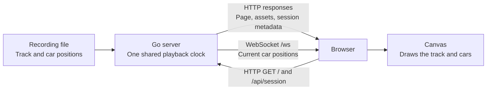

# F1 Race Replay project guide

F1 Race Replay lets people study a race moment by replaying car positions on a track map. A shared timeline lets two viewers discuss the same moment, even if one joins midway. Milestone 1 proves that flow locally with two fictional cars and one Go process.

## Architecture

### When HTTP and WebSocket come in

1. **Load the page over HTTP.** The browser requests `GET /` for the HTML, then fetches its JavaScript and CSS with separate HTTP requests.
2. **Fetch the map over HTTP.** The JavaScript calls `GET /api/session` once on page load. Go returns a JSON response containing the circuit outline, driver IDs, and clip duration.
3. **Open the position stream.** The browser connects to `/ws`. In this app, that starts as an HTTP/1.1 upgrade request. Go replies with `101 Switching Protocols` and the connection stays open as a WebSocket. The server sends the current frame immediately, then sends a new snapshot every 200 ms during steady playback.

HTTP request and response fit the page and map because the browser needs them once. A WebSocket lets the server push changing positions over one open connection. Polling could do the job with repeated requests. Server-Sent Events (SSE) could also carry this one-way stream. WebSockets support messages in both directions if shared playback controls are added later.

To see the difference, open the browser's Network tab and reload. Inspect the JSON response from `/api/session`, then open the `/ws` connection and watch messages keep arriving.

## Technologies to know

| Technology | What to understand |
| --- | --- |
| **Go and `net/http`** | A route maps to a handler. Each WebSocket connection has its own send loop, timer, and write timeout. Learn how handlers share the recording and start time while each manages its own connection. |
| **HTTP and WebSocket** | Be able to explain the page request, the metadata response, the upgrade, and what happens when a socket disconnects. |
| **JSON, JavaScript, and Canvas** | JSON is the data format both sides agree on. JavaScript parses each frame and draws a dot at each driver's `x` and `y` on the canvas. |

## Data model and decisions

| Model | What it stores and why |
| --- | --- |
| **Session metadata** | Circuit name, outline, driver IDs, and clip duration. The browser fetches these once so every frame can focus on changing positions. |
| **Recording** | An interval and an array of position snapshots. The snapshots are 200 ms apart, so Go can look up a row by dividing elapsed time by the interval. The small demo file is loaded into memory at startup. |
| **Stream frame** | `sequence` counts intervals since the process started. `elapsedMs` is the time within the clip and wraps at the end. `positions` contains each driver's ID and map coordinates. Driver IDs are strings, so `"01"` keeps its leading zero. |

One server clock means late joiners receive the current frame as soon as they connect. Sending **full snapshots** means any one message is enough to draw the cars, even after a skipped update. The trade-off is sending every car's coordinates in each message. Smaller change-only messages would require an initial snapshot and a way to recover missed changes.

## Where to look in the code

| Start here | What it does |
| --- | --- |
| [testdata/demo.json](testdata/demo.json) | Stores the synthetic track and 60 sets of car positions. |
| [main.go](main.go) | Loads the recording, starts the clock, and registers the routes. |
| [replay.go](replay.go) | Defines the data types and uses `frameAt` to select a row in the clip. |
| [stream.go](stream.go) | Upgrades the connection, sends frames, and skips ahead if a write falls behind. |
| [web/viewer.js](web/viewer.js) | Fetches the session, opens the socket, and calls `ctx.arc` to place each car. |

## Trace one frame

At **11,800 ms** since startup, `frameAt` divides by 200 to get sequence **59**. With 60 saved frames, that picks index **59**, the last row. At **12,000 ms**, the sequence reaches **60**, the index wraps to **0**, and the browser shows **0:00.0**.

In the running demo, open **Inspect a frame** and take its sequence modulo 60. Find that row in the `frames` array and compare car `01`'s coordinates with the snapshot. The tests cover timing boundaries, wraparound, and two late joiners getting the current frame. [Replay tests](replay_test.go) · [WebSocket tests](stream_test.go)

## Think like a system designer

- **Where does the authoritative state live?** The recording comes from the file. The running Go process owns the playback clock. Two server processes started at different times would have different playback positions.
- **How does the client recover?** After a disconnect, the browser retries and can draw the first full frame it gets. If the process itself restarts, it starts a new timeline because the old start time lived in memory.
- **What grows with more viewers?** At five frames per second, 200 connected viewers would mean about 1,000 outbound messages per second at full cadence. That's a rough estimate for a future load test. Measure message size and watch CPU and network use to see what actually limits the app.

**Next milestone.** Import one historical race clip into the same frame format.

Update this guide when a milestone ships. Revise the flow and file list in place, and keep the decisions and limits that still apply.
