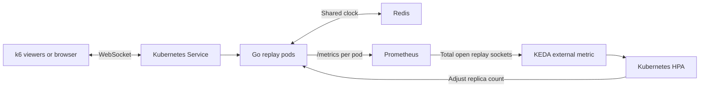

# Milestones 4 and 5 · Scaling and recovery

## What to say in an interview

> The Go WebSocket handler increments a gauge after a connection is accepted and decrements it when the connection ends. Prometheus scrapes each pod separately. KEDA exposes the sum of those active connections to Kubernetes’ Horizontal Pod Autoscaler, which adjusts how many Go replicas are serving the replay.
>
> Connections are a useful signal because a viewer can keep a socket open for a long time. An initial request count would miss that ongoing work. We keep two replicas available and use a target of 60 active sockets per replica for the local setup. At 220 connections the target is four replicas, capped at four. New pods can accept new or reconnecting viewers. Existing sockets stay on the pod that accepted them.
>
> If a serving pod goes away, the client opens a new socket through the Service and the new server computes the current frame from the same Redis clock. The browser retries after a close or after three seconds without a frame. I verify recovery using the time from the last valid frame to the first correctly aligned frame after reconnect. That measures the gap the viewer experiences and includes disconnect detection. A surviving pod can restore playback while Kubernetes is still replacing the failed pod.

## Delivery and control flow



| Choice | Why |
| --- | --- |
| **Gauge per pod** | Counts concurrent work and falls on disconnect. Prometheus discovers each pod and includes its name in the target label. Scraping one load-balanced Service address could miss pods and miscount the total. |
| **Total connections with an average target** | Prometheus returns a single value. KEDA and the HPA turn the total into a target number of pods. The local target is a scale-test setting. A production threshold would come from frame sizes, CPU, latency, and headroom under load. |
| **Two-pod floor and delayed scale-down** | A pod remains available if a serving pod fails. Scale-down stabilization reduces churn during short reconnect waves. Scale-up increases capacity for new connections. |
| **One Redis clock and recording** | A replacement pod can load the same recording and resolve the playhead at startup. The readiness endpoint is reachable after recording and Redis clock initialization. |
| **k6 run paired with pod deletion** | The driver waits for Prometheus to observe at least 200 concurrent connections and Kubernetes to report four available pods. It then deletes a pod with live viewers. The run must observe as many successful recoveries as the victim pod’s connection count. k6 requires each interruption to recover within 10 seconds and checks that the first recovered frame matches the expected sequence within one second of timing jitter. |

[KEDA Prometheus scaler](https://keda.sh/docs/2.21/scalers/prometheus/) · [k6 WebSockets](https://grafana.com/docs/k6/latest/javascript-api/k6-websockets/) · [Redis clock](REDIS_CLOCK.md)

## Start the local cluster

Requires Docker, kind 0.33, kubectl, and a generated Barcelona recording. The kind config pins Kubernetes 1.36.4, in the tested range for KEDA 2.21.0. [KEDA compatibility](https://keda.sh/docs/2.21/operate/cluster/#kubernetes-compatibility)

```sh
export KUBECONFIG="$PWD/.recordings/kind-kubeconfig"
kind create cluster --name f1-replay --config deploy/kind.yaml

docker build --target barcelona --build-context recording=.recordings -t f1-race-replay:local .
kind load docker-image f1-race-replay:local --name f1-replay

kubectl --context kind-f1-replay apply --server-side -f https://github.com/kedacore/keda/releases/download/v2.21.0/keda-2.21.0.yaml
kubectl --context kind-f1-replay apply -f deploy/local.yaml
kubectl --context kind-f1-replay -n keda wait --for=condition=available deployment --all --timeout=120s
kubectl --context kind-f1-replay -n f1-replay rollout status deployment/replay --timeout=120s
kubectl --context kind-f1-replay apply -f deploy/autoscale.yaml
```

The [local cluster viewer](http://127.0.0.1:18089/) is bound to loopback. This build packages the generated recording into a local test image so the cluster can run the full race. The Go server also supports an S3 object at startup. The two-replica S3 path was verified separately against Moto.

## What the first load test changed

The initial run reached 220 connected viewers and four available pods. After the pod deletion, 84 of 114 interrupted viewers recovered within 10 seconds. The longest observed gap was 60.6 seconds. The distribution of handshake times pointed to stalled reconnect attempts. We added a three-second frame watchdog to the viewer and a bounded retry cadence to the k6 client. A Playwright test covers an open socket that stops delivering frames. Three seconds allows roughly 15 expected frames to go missing before reconnecting. A shorter timeout would react faster at the cost of extra reconnects during temporary network stalls.

## Verified local run

The final run used the full Barcelona recording on a local kind cluster with Kubernetes 1.36.4, KEDA 2.21.0, Prometheus 3.16.0, Redis 7.4.12, and k6 2.1.0.

| Measurement | Result |
| --- | --- |
| Concurrent WebSockets observed by Prometheus | 220 |
| Available replay pods before disruption | Scaled from 2 to 4 |
| Connections on the deleted serving pod | 129 |
| Disrupted viewers receiving an aligned frame within 10 seconds | 129 of 129 |
| Recovery gap, measured from last good frame to first aligned frame | 1.207 seconds at p95, 1.208 seconds maximum |
| Completed k6 iterations | 220 of 220 |
| Valid frame messages scored by k6 | 98,442 of 98,442 |

The load driver completed successfully. The result applies to one deleted app pod on local Kubernetes, with Redis and surviving app pods still available.

## Run the load and recovery test

Install k6 2.1 and run the driver when the replay Deployment has two available pods. It deletes one serving pod on the disposable `kind-f1-replay` cluster.

```sh
load/verify-kubernetes.sh
```

The driver prints the results directory. `summary.json` contains the recovery trend and thresholds, `k6.log` has the test output, and `fault.tsv` records the observed active connections, available replicas, disrupted pod, and that pod’s connection count. For another run, wait for the autoscaler to return to two available pods.

[Local Kubernetes manifests](../deploy/local.yaml) · [Autoscaling config](../deploy/autoscale.yaml) · [k6 scenario](../load/recovery.js) · [Run driver](../load/verify-kubernetes.sh)
