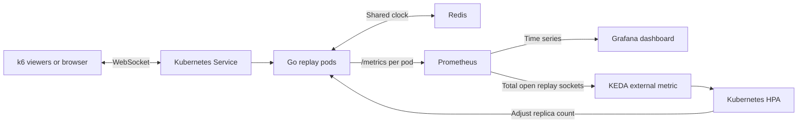

# Kubernetes, monitoring, and recovery

Start with [how the app scales and a viewer recovers](STACK_GUIDE.md#how-the-app-scales-and-a-viewer-recovers) for an introduction to the tools.

## How scaling and recovery work

The Go WebSocket handler counts open connections. Prometheus scrapes each pod, KEDA exposes the total as an external metric, and Kubernetes’ Horizontal Pod Autoscaler (HPA) adjusts the Deployment. The local policy keeps two pods available and targets an average of 60 open sockets per pod, up to four pods. A new pod can accept new or reconnecting viewers. Existing sockets stay on the pods that accepted them.

When a serving pod goes away, clients reconnect through the Service. The new server computes the current frame from the same Redis clock. The browser retries after a close or after three seconds without a frame. The load test measures from the last valid frame to the first correctly aligned frame after reconnect. It includes time spent detecting the disconnect. A surviving pod can restore playback while Kubernetes is still replacing the failed pod.

## Delivery and control flow



| Choice | Why |
| --- | --- |
| **Gauge per pod** | Counts concurrent work and falls on disconnect. Prometheus discovers each pod and includes its name in the target label. Scraping one load-balanced Service address could miss pods and miscount the total. |
| **Total connections with an average target** | Prometheus returns a single value. KEDA and the HPA turn the total into a target number of pods. The local target is a scale-test setting. A production threshold would come from frame sizes, CPU, latency, and headroom under load. |
| **Two-pod floor and delayed scale-down** | The minimum replica count gives viewers another pod to reconnect to after one pod fails. Scale-down stabilization reduces churn during short reconnect waves. Scale-up increases capacity for new connections. |
| **One Redis clock and recording** | A replacement pod can load the same recording and resolve the playhead at startup. The readiness endpoint is reachable after recording and Redis clock initialization. |
| **k6 run paired with pod deletion** | The driver waits for Prometheus to observe at least 200 concurrent connections and Kubernetes to report four available pods. It then deletes a pod with live viewers. The run must observe at least as many successful recoveries as the deleted pod’s connection count at the pre-deletion scrape. k6 requires each interruption to recover within 10 seconds and checks that the first recovered frame matches the expected sequence within one second of timing jitter. |

[KEDA Prometheus scaler](https://keda.sh/docs/2.21/scalers/prometheus/) · [k6 WebSockets](https://grafana.com/docs/k6/latest/javascript-api/k6-websockets/) · [Redis clock](REDIS_CLOCK.md)

## Start the local cluster

Run these commands from the repository root. Start Docker Desktop and check that Docker, kind 0.33, and kubectl are available. Prepare the Barcelona file using the [historical replay instructions](../README.md#historical-replay) before building the image. The kind config pins Kubernetes 1.36.4, in the tested range for KEDA 2.21.0. [KEDA compatibility](https://keda.sh/docs/2.21/operate/cluster/#kubernetes-compatibility)

```sh
export KUBECONFIG="$PWD/.recordings/kind-kubeconfig"
kind create cluster --name f1-replay --config deploy/kind.yaml

docker build --target barcelona --build-context recording=.recordings -t f1-race-replay:local .
kind load docker-image f1-race-replay:local --name f1-replay

kubectl --context kind-f1-replay apply --server-side -f https://github.com/kedacore/keda/releases/download/v2.21.0/keda-2.21.0.yaml
kubectl --context kind-f1-replay apply -f deploy/local.yaml
kubectl --context kind-f1-replay -n keda wait --for=condition=available deployment --all --timeout=120s
kubectl --context kind-f1-replay -n f1-replay rollout status deployment/replay --timeout=120s
kubectl --context kind-f1-replay apply -f deploy/autoscale.yaml
```

The [local cluster viewer](http://127.0.0.1:18089/) is bound to loopback. This build packages the generated recording into a local test image so the cluster can run the full race. The Go server also supports an S3 object at startup. The two-replica S3 path was verified separately against Moto.

## View the Grafana dashboard

Once the local stack is running, install the optional dashboard. Grafana starts with a Prometheus data source and the dashboard from this repository. Kustomize packages those files into ConfigMaps, and their names change when the content changes so the Deployment reloads them.

```sh
kubectl --context kind-f1-replay apply -k deploy/grafana
kubectl --context kind-f1-replay -n f1-replay rollout status deployment/grafana --timeout=180s
kubectl --context kind-f1-replay -n f1-replay port-forward --address 127.0.0.1 service/grafana 13000:3000
```

Open [F1 Race Replay in Grafana](http://127.0.0.1:13000/d/f1-replay-overview/f1-race-replay) and keep the port-forward running while you run the [load test](#run-the-load-and-recovery-test) in another terminal. The local dashboard uses anonymous viewer access over the loopback port-forward.

| Panel | What to look for |
| --- | --- |
| **Total open WebSockets** | The same Prometheus sum KEDA uses. Watch the load ramp up as k6 viewers connect. |
| **Replay pods responding to Prometheus** | Counts pods with a successful scrape. The test driver separately checks the Deployment’s available replicas through Kubernetes. |
| **Open WebSockets by replay pod** | Watch new series appear after scale-up, the deleted pod’s series end, and connections appear on surviving pods. Use the UTC timestamp printed by the driver to locate the deletion. |

Grafana shows sampled server metrics. It can miss short disconnects between scrapes. Use k6’s recovery and frame checks to determine what viewers experienced. To remove Grafana, stop the port-forward and run `kubectl --context kind-f1-replay delete -k deploy/grafana`.

[Screenshot from the 220-viewer rerun](images/grafana.png) · [Dashboard definition](../deploy/grafana/replay.json) · [Grafana provisioning](https://grafana.com/docs/grafana/latest/administration/provisioning/)

## What the first load test changed

The initial run reached 220 connected viewers and four available pods. After the pod deletion, 84 of 114 interrupted viewers recovered within 10 seconds. The longest observed gap was 60.6 seconds. The distribution of handshake times pointed to stalled reconnect attempts. We added a three-second frame watchdog to the viewer and a bounded retry cadence to the k6 client. A Playwright test covers an open socket that stops delivering frames. Three seconds allows roughly 15 expected frames to go missing before reconnecting. A shorter timeout would react faster at the cost of extra reconnects during temporary network stalls.

## Verified local run

This recorded passing run used the full Barcelona recording on a local kind cluster with Kubernetes 1.36.4, KEDA 2.21.0, Prometheus 3.16.0, Redis 7.4.12, and k6 2.1.0.

| Measurement | Result |
| --- | --- |
| Concurrent WebSockets observed by Prometheus | 220 |
| Available replay pods before disruption | Scaled from 2 to 4 |
| Connections on the deleted serving pod | 129 |
| Disrupted viewers receiving an aligned frame within 10 seconds | 129 of 129 |
| Recovery gap, measured from last good frame to first aligned frame | 1.207 seconds at p95, 1.208 seconds maximum |
| Completed k6 iterations | 220 of 220 |
| Valid frame messages scored by k6 | 98,442 of 98,442 |

The load driver completed successfully. The result applies to one deleted app pod on local Kubernetes, with Redis and surviving app pods still available.

## Grafana verification runs

Both reruns with Grafana installed reached 220 concurrent WebSockets, grew from two to four available replicas, and finished all 220 k6 iterations. The driver deleted a pod with 118 connections each time. k6 counts interruptions across every viewer, so that total can exceed the pre-deletion connection count.

| Run | Interruptions recovered within 10 seconds | Longest gap | Result |
| --- | --- | --- | --- |
| First rerun | 124 of 134 | 47.682 s | Recovery threshold failed |
| Repeat | 118 of 118 | 1.102 s | All thresholds passed |

The dashboard [screenshot](images/grafana.png) is from the passing repeat. The driver requested pod deletion at 16:49:30 UTC. The per-pod chart shows the deleted pod’s series ending and surviving pods accepting its viewers. The cause of the slower first rerun remains unconfirmed. The results show that recovery can vary even when the deployment reaches the same connection and replica counts.

## Run the load and recovery test

Install k6 2.1 and run the driver when the replay Deployment has two available pods. It deletes one serving pod on the disposable `kind-f1-replay` cluster.

```sh
load/verify-kubernetes.sh
```

The driver prints the results directory. `summary.json` contains the recovery trend and thresholds, `k6.log` has the test output, `fault.tsv` records the observed active connections, available replicas, disrupted pod, and that pod’s connection count, and `fault-time.txt` records when the driver requested the deletion in UTC. For another run, wait for the autoscaler to return to two available pods.

[Local Kubernetes manifests](../deploy/local.yaml) · [Autoscaling config](../deploy/autoscale.yaml) · [k6 scenario](../load/recovery.js) · [Run driver](../load/verify-kubernetes.sh)
