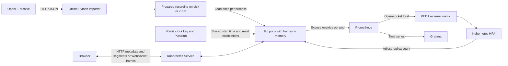
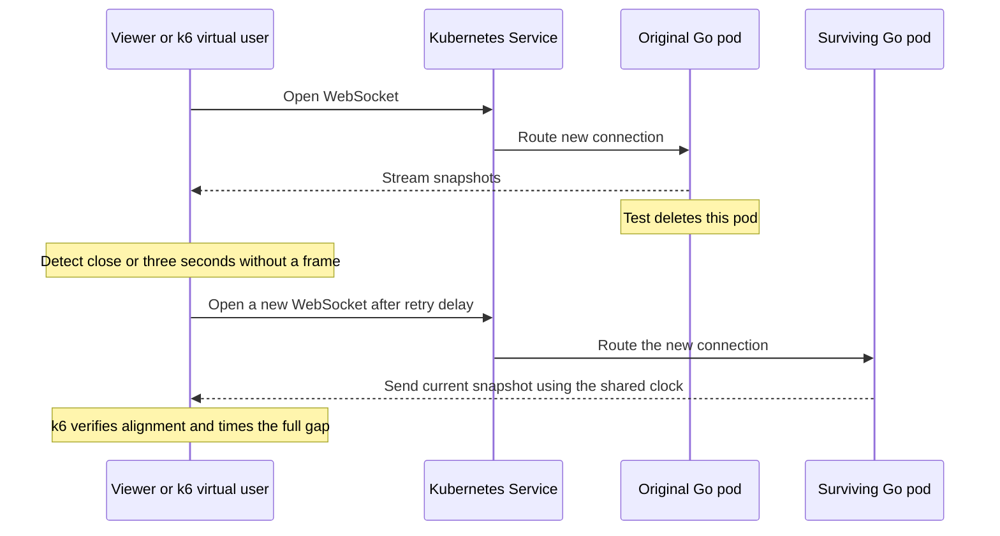

# F1 Race Replay technical guide

F1 Race Replay renders a historical race from telemetry. A viewer can scrub independently or join shared playback, where people connected to different servers see approximately the same race moment.

**Start with the diagram and the two interview walkthroughs.** Then read sections 1 and 2 to learn how the paths work. The tables on alternatives and next steps are for deeper follow-up questions.

- [1. Follow a frame from OpenF1 to the browser](#1-follow-a-frame-from-openf1-to-the-browser)
- [2. Follow a viewer through a pod failure](#2-follow-a-viewer-through-a-pod-failure)
- [3. Defend the résumé bullets](#3-defend-the-résumé-bullets)
- [4. Explain what you would change next](#4-explain-what-you-would-change-next)



| State | Where it lives | Why |
| --- | --- | --- |
| Race recording | A JSON object on disk or in S3, decoded into memory by each Go process | The recording is read-only. All replicas can serve their own copies without fetching each frame from storage. |
| Shared playback start time | A Redis key scoped to the recording hash, mirrored as a local clock in each replica | Every replica can calculate the current frame even if another replica accepts the connection. |
| Personal playhead and recent segments | In the browser | A viewer can pause or seek without changing anyone else's playback. |
| Open connections | On the Go process that accepted each socket | Each socket belongs to one process. Reconnecting creates a new socket that can land on a different pod. |

## 1. Follow a frame from OpenF1 to the browser

### Python turns irregular samples into a recording

The importer runs **before** the server. Python's standard library handles the HTTP requests, JSON, time conversion, and sorting. This work has a batch input and a deterministic artifact as output, which makes it straightforward to rerun and test on saved inputs. The same code could live in Go. Keeping it as a separate script is the architectural decision that prevents viewers from waiting on OpenF1 or on data cleanup. [Full-grid importer](../../tools/import_barcelona_grid.py) · [Shared importer logic](../../tools/import_barcelona.py)

1. **Fetch.** The full-grid importer requests OpenF1's Barcelona session `11307`. It reads driver info, coordinates, laps, running order, gaps and intervals, pits, tyre stints, race control, and final results. Location data comes in five-minute windows padded by one second on either side. Padding lets observations near a window boundary still bracket a frame. The importer saves successful responses to disk and retries transient errors with backoff, up to three attempts. [Source loading](../../tools/import_barcelona_grid.py) · [Fetch and retry](../../tools/import_barcelona.py)
2. **Normalize.** The session-start message defines the replay's time zero. For each driver, the importer filters null or non-finite coordinates, sorts by timestamp, collapses identical duplicates, and rejects conflicting coordinates for the same millisecond. It projects the reference track and cars into the same map coordinate space. [Sample cleanup and map projection](../../tools/import_barcelona.py)
3. **Resample.** A frame represents the positions available at a single time. Every **200 ms**, Python looks for an exact observation or uses linear interpolation between the surrounding samples. For example, X moves from 100 at 0 ms to 140 at 400 ms, so X is estimated as 120 at 200 ms. If the samples are over one second apart or the requested time is outside the observed range, the frame omits that car. The cutoff trades occasional missing cars for fewer misleading jumps across the circuit. [Resampling code](../../tools/import_barcelona.py) · [Importer tests](../../tools/test_import_barcelona.py)

The full recording holds **28,135 frames for 22 drivers** and is about **24 MiB as plain JSON on disk**. The file stores a session object with track geometry, driver IDs and timing history, a frame interval, and an ordered array of position frames. Lap times, flags, tyres, and running order are separate time series inside the session. Those values change at different rates, so copying them into every frame would waste space. The browser uses a frame's race time to retrieve the relevant timing values. A lapped car can be physically ahead of the leader on a straight, so the leaderboard uses recorded race order. [Go data types](../../replay.go) · [Browser timing lookup](../../web/timing-tower.js)

**Why precompute?** At 10 seconds, Go divides 10,000 by 200 and looks up frame 50. Selecting the frame is constant-time array indexing. Serializing and transmitting it still costs work proportional to its size. Keeping only raw observations would shrink the prepared artifact but require searching and interpolating during reads or introducing another cache. A finer interval would smooth movement at the cost of more frames in storage and higher message rates if streamed at that cadence.

### S3 stores an artifact and Go loads it

**Amazon S3** is object storage. A bucket holds named objects, and a key identifies one object within a bucket. With `-recording s3://bucket/key`, the Go server loads the AWS SDK configuration and calls `GetObject`. The object is the prepared race file. The importer writes the file locally, so putting it in S3 is a separate step. The server can also read the file from disk or use the embedded demo. [S3 loader](../../s3.go) · [AWS GetObject](https://docs.aws.amazon.com/AmazonS3/latest/API/API_GetObject.html) · [Configuration](../CONFIGURATION.md#load-a-recording-from-s3)

`readRecording` reads the bytes, decompresses gzip if present, decodes JSON into Go structs, and validates the recording. It hashes the JSON bytes after decompression with SHA-256. That makes a gzip copy and a plain copy of the same JSON share an identity. Reserializing the same logical content with different bytes can produce a different identity. Go sets the HTTP recording version to `v1-<hash>`, using `v1` for the segment API format, and uses the underlying hash to scope the Redis clock. The server starts listening only after the recording and any configured Redis clock have initialized. [Startup and versioning](../../main.go) · [Recording validation](../../replay.go)

| Choice | Why it fits | When an alternative would help |
| --- | --- | --- |
| **Object storage for the finished recording** | Serving replicas need the same immutable artifact identified by a key. Object storage keeps the artifact independent of a particular server or image. | A relational database would help if the product needed to query across races and drivers, or frequently update structured records. The current access pattern is one known recording plus direct frame lookup. |
| **Load once into each Go process** | Frame selection avoids storage requests and can use immutable slices shared by all handlers in that process. | An indexed segment store would reduce memory and startup work for a larger catalog. A cold seek would then depend on storage or cache latency. |
| **Go for the serving process** | `net/http` serves HTTP routes and gives concurrent handlers for sockets. Go's goroutines, timers, and cancellation map directly to the per-connection send loop. The build produces a single executable with the viewer embedded. | Node's async I/O or an async Python server could implement the same architecture. The repository has no language benchmark. The relevant benefits here are a small deployable binary and a straightforward concurrency model. |

### HTTP handles seeks and WebSockets handle shared playback

**Personal analysis.** The browser receives track geometry, frame interval, segment size, version, and initial navigation data from `/api/session`. For the full grid, it starts the heavier `/api/timing` request after the first frame. Go pre-encodes the full timing response once in plain and gzip forms because the data is immutable. If the timing request fails, the map can still render positions. [HTTP routes](../../main.go) · [Viewer initialization](../../web/viewer.js)

A full-grid segment is **20 seconds, or 100 frames at 200 ms each**. A scrub to 24.3 seconds gives frame 121, in segment 1 at offset 21. An event jump instead rounds up to the first frame at or after the event. The browser fetches only the required segment. It keeps up to five decoded segments in memory, shares an in-flight fetch for matching requests, and starts prefetching the next segment at about 80% of the current one. A request generation number stops an older seek response from moving the playhead after a newer seek. [Segment and seek implementation](../../web/analysis.js)

The cache path is **browser memory → HTTP cache → Go's loaded recording**. The versioned URL includes the recording hash and segment index. Go returns an immutable cache header for that version and `Vary: Accept-Encoding` so caches distinguish gzip and plain responses. A different recording hash produces different URLs. A request for an unknown version gets a non-cacheable 404. Redis has no role in this lookup. Shorter segments would reduce cold-seek bytes and increase the request count during continuous playback. [Segment HTTP handler](../../main.go) · [Cache and compression tests](../../segments_test.go)

**Shared playback.** The browser upgrades an HTTP request at `/ws` into a persistent WebSocket. Each accepted connection has its own Go handler loop. The first timer fires immediately, and the handler calculates and sends the current frame from the shared clock. It schedules the next send against the next clock boundary. It recalculates after each write, so a slow connection can skip stale positions. Each JSON write has a **two-second deadline**. Closed connections end their handlers and decrement the open-socket gauge. [WebSocket protocol](https://datatracker.ietf.org/doc/html/rfc6455) · [Send loop](../../stream.go)

```text
sequence    = floor(elapsed_since_shared_start_ms / frame_interval_ms)
frame_index = sequence % number_of_frames
race_time   = frame_index * frame_interval_ms
```

Each WebSocket message carries `sequence`, `elapsedMs` within the recording, and `positions`, a complete position snapshot for that instant. The sequence keeps increasing across loops. The race time wraps, so the browser can look up the correct timing after the loop. An operator reset starts a new timeline near sequence zero. A reconnecting viewer can render a single fresh snapshot without rebuilding earlier messages. [Frame selection](../../replay.go) · [Stream tests](../../stream_test.go)

| Alternative | What would change |
| --- | --- |
| **HTTP polling** | Polling every 200 ms would issue about five HTTP requests per viewer per second, or about 1,100 requests per second at 220 viewers. Slower polling reduces requests and gives coarser updates. |
| **Server-Sent Events (SSE)** | A valid alternative for the current one-way stream. Browser `EventSource` supports reconnecting and text events. WebSockets provide a two-way channel if shared controls are added. Current viewers only receive application messages on the socket. |
| **Sync the browser clock and fetch segments** | The browser already knows how to read segments, so it could receive occasional clock corrections and render locally. A CDN could serve immutable segments at large scale. Clients would need to reconcile drift, late joins, and buffering. |
| **Send deltas or use a binary format** | This could reduce bytes per message. Deltas require a baseline and a resync strategy after skips or reconnects. JSON snapshots make the protocol easy to inspect and let a new connection start from any frame. |

[Server-Sent Events standard](https://html.spec.whatwg.org/multipage/server-sent-events.html) · [Browser socket connection](../../web/viewer.js)

### Redis keeps replicas on the same timeline

The problem is **clock agreement**. Two Go pods can load identical frames and disagree about the current frame if they independently start 20 seconds apart. At five frames per second, that's roughly 100 frames of difference. Redis gives them one authoritative playback start time per recording. [Clock implementation](../../replay_clock.go)

1. **Initialize or reset atomically.** The Lua script calls Redis `TIME`, reads the epoch key, and sets it when missing or explicitly reset. On a change, it publishes to the recording's channel. Concurrent new pods see one start time. The key has the form `f1-replay:<recording-hash>:clock`, and the topic also includes the Redis database number. [Lua script and key construction](../../replay_clock.go)
2. **Convert the epoch to a local clock.** Redis returns the stored start and its current time. If the difference is 20 seconds, Go estimates when that response was sampled using the request's round-trip midpoint and anchors its local start 20 seconds earlier. Each handler reads that anchor from an atomic pointer and uses Go's monotonic clock to measure elapsed time. The hot path has zero Redis calls per frame. Network asymmetry and clock drift can still introduce small differences. [Clock refresh](../../replay_clock.go)
3. **Repair missed updates.** Redis Pub/Sub is at-most-once. A subscriber that disconnects can miss the reset notification. The watcher rereads the authoritative key on a notification and also polls it every **two seconds**. It updates the local anchor only when the Redis epoch changes. This repairs a missed reset after Redis is reachable and explains why periodic polling doesn't continuously correct clock drift. [Clock watcher](../../replay_clock.go) · [Redis Pub/Sub delivery semantics](https://redis.io/docs/latest/develop/pubsub/#delivery-semantics)

| Alternative | Why the project uses a Redis key and Pub/Sub |
| --- | --- |
| **A process-local clock or sticky sessions** | A local clock works for one server. Sticky routing keeps a viewer on a server while it lives, but different servers would still disagree and a viewer could lose alignment after a pod failure. |
| **A shared database row and polling** | A SQL row could hold the epoch and polling alone could reconcile changes. The project uses Redis for an atomic update and a low-latency notification, with polling as a repair path. |
| **Redis Streams or Kafka** | A durable event log would help if consumers needed the full history of playback commands or guaranteed replay. Here replicas need the latest clock value. Keeping that value in a key avoids replaying older resets. |

If Redis becomes unavailable, running replicas keep their last anchor and can continue serving. A new replica configured with Redis fails startup if it can't initialize the clock. The local manifest enables Redis append-only persistence on an `emptyDir` volume. That can survive a container restart within the same pod, while deleting that Redis pod removes the volume and can erase its epoch. After epoch loss, the next successful initialization can establish a new timeline. The pod-deletion test covers a **Go replay pod** failure with Redis available. [Redis manifests](../../deploy/local.yaml) · [Late-join, reset, and missed-notification tests](../../replay_clock_test.go)

## 2. Follow a viewer through a pod failure

### Docker packages the app and Kubernetes keeps copies running

The **Dockerfile** compiles Go in a build stage and copies the executable and CA certificates into a small runtime image that runs as a non-root user. The viewer and fictional demo are embedded in the Go executable. The Barcelona image target adds the full race file for the local test. That keeps the cluster test reproducible without network access to the race archive or S3. An external artifact is preferable when recordings need to change independently of server releases. [Dockerfile](../../Dockerfile) · [Embedded assets and startup](../../main.go)

**Kubernetes** adds several distinct pieces:

- A **pod** is the unit Kubernetes schedules. Each replay pod here runs one Go server and holds its own decoded race and active WebSockets.
- The **Deployment** maintains the desired pod count. If a pod disappears, Kubernetes creates a replacement to reach that count.
- The **Service** gives clients one address. The local **NodePort** exposes the Service, and the kind configuration maps it to a loopback port. Each new connection can reach an available pod. An established WebSocket stays attached to the process that accepted it.
- The **readiness probe** sends HTTP requests to `/readyz`. The endpoint is reachable only after the server starts listening following recording and clock initialization. It currently returns a simple success response. It does not query Redis continuously or measure stream health. [Local manifests](../../deploy/local.yaml) · [kind port mapping](../../deploy/kind.yaml)

A single binary or Docker Compose would be sufficient for a local viewer. The Kubernetes setup is useful for a specific experiment: discovery of changing replicas, automatic scaling from a custom metric, and reconnecting through a Service after a pod is removed. **kind** runs that Kubernetes setup locally. **EKS** manages the Kubernetes control plane on AWS and would require separate cloud deployment and verification. [Reproduce the local setup](../DEPLOYMENT.md)

### Prometheus measures load, KEDA provides the metric, and HPA scales

1. **Go instruments the workload.** After accepting a WebSocket, the handler increments `f1_replay_websocket_connections`. A deferred decrement runs when the handler exits. This is a **gauge**, a measurement that can increase or decrease. A cumulative connection counter could measure arrivals, but it would keep rising after viewers leave. [Gauge registration](../../main.go) · [Connection lifecycle](../../stream.go) · [Prometheus metric types](https://prometheus.io/docs/concepts/metric_types/)
2. **Prometheus scrapes the pods.** The local config discovers replay pods through the Kubernetes API, labels the time series with the pod name, and requests each pod's `/metrics` every two seconds. Pod discovery matters because scraping the load-balanced app Service could hit one replica and miss the others. `sum(f1_replay_websocket_connections{job="replay"})` adds the sampled values across the replicas. [Service discovery and scrape config](../../deploy/local.yaml)
3. **KEDA exposes an external metric to the HPA.** The `ScaledObject` selects the replay Deployment, uses the Prometheus query as its trigger, and sets `metricType: AverageValue`. KEDA supplies the aggregate metric. The Kubernetes **Horizontal Pod Autoscaler** uses it to adjust the Deployment's desired replica count. The target is **60 open sockets per replica**, with a minimum of two and maximum of four. At 220 sockets the target is `ceil(220 / 60) = 4`, subject to the autoscaler's timing and rules. A 120-second scale-down stabilization window keeps a short drop in load from immediately removing capacity. [ScaledObject](../../deploy/autoscale.yaml) · [KEDA Prometheus scaler](https://keda.sh/docs/2.21/scalers/prometheus/) · [Kubernetes HPA](https://kubernetes.io/docs/concepts/workloads/autoscaling/horizontal-pod-autoscale/)

**Why use open sockets instead of request rate or CPU alone?** A WebSocket's HTTP handshake happens once, but each open connection keeps receiving frames. At five frames per second, 220 active sockets can produce roughly **1,100 frame messages per second** at full cadence. Socket count tracks ongoing work for this fixed recording. CPU, network bytes, write delays, and per-pod imbalance would add context under mixed traffic. The setting of 60 is a test input. It is not a measured safe capacity. New pods handle new or reconnecting clients, so the cluster average can hide an overloaded pod and existing sockets stay in place during scale-up.

**Why KEDA?** A CPU-based HPA would be simpler if CPU were the signal we needed. To scale on socket counts, a Prometheus adapter could also expose metrics to an HPA. KEDA lets the app declare a Prometheus query, target, and replica bounds in one resource while retaining Kubernetes' HPA controller. The extra dependency is a trade-off. If Prometheus stops producing usable samples, this scaling policy loses its input while already-running replay processes can still serve viewers.

### Grafana explains cluster behavior

Grafana queries the **same Prometheus data** independently of KEDA. The total-open-connections panel lets you compare demand with the scaler input. The per-pod panel lets you see uneven placement and where connections appear after deletion. The panel based on `up` counts targets that Prometheus can successfully scrape. The test separately checks Kubernetes' available replicas, since a successful scrape answers a different question. [Dashboard JSON and queries](../../deploy/grafana/replay.json) · [Dashboard screenshot](../images/grafana.png)

Prometheus' query UI is enough for an ad hoc number. Grafana makes it easier to compare the per-pod and aggregate series over the same time window, and the dashboard and data source are checked in as provisioning files. Neither sampled view can time a short gap between two frames on a client. k6 provides that measurement. [Grafana manifests](../../deploy/grafana) · [Grafana provisioning](https://grafana.com/docs/grafana/latest/administration/provisioning/)

### k6 measures whether playback actually resumes



The **test driver** starts with two available pods. It launches k6 with 220 virtual users for 90 seconds. It waits until Kubernetes reports four available pods and Prometheus observes at least 200 simultaneous open sockets. Then it deletes the pod with the most sockets in that sample. The deletion tests an abrupt failure while Redis and other Go pods are available. [Test driver](../../load/verify-kubernetes.sh)

Each **virtual user** opens its own socket and validates frame messages. The browser and k6 both respond to a close event or a three-second watchdog for a missing frame. They retry after about one second. The watchdog matters because a socket can appear open while no frames arrive. A shorter timeout would detect stalls sooner and could also cause unnecessary retries on slow connections. After reconnect, the new Go pod sends the current frame from its own copy of the recording and its synchronized clock. The viewer can resume before the deleted pod is replaced. [Browser reconnect code](../../web/viewer.js) · [k6 WebSocket scenario](../../load/recovery.js)

**A recovery starts at the last valid frame before the interruption and ends at the first correctly aligned frame after reconnect.** k6 checks that the sequence is valid and that `elapsedMs` matches the wrapped frame index. It predicts the new sequence from the last good sequence and the time elapsed between arrivals. The frame must be within one second of that prediction. The 10-second recovery threshold applies to the whole gap, including detection, retry, handshake, and alignment. The test requires an interruption, all configured sessions to start and finish, valid frame checks, and every observed interruption to recover within 10 seconds. An unrecovered interruption at the end also fails. [Checks and thresholds](../../load/recovery.js) · [k6 thresholds](https://grafana.com/docs/k6/latest/using-k6/thresholds/)

**Why k6 alongside Playwright?** Playwright verifies what a real browser displays and tests scenarios such as a socket that remains open but goes quiet. k6 is suited to running many scripted connections and enforcing thresholds. Its frame validation measures the protocol from the client side. Browser rendering, WAN performance, and failures of Redis or multiple pods would need separate tests. [Browser recovery tests](../../tests/browser/replay.spec.mjs) · [k6 scenario](../../load/recovery.js)

### What the measurements showed

| Experiment | Result | What it supports |
| --- | --- | --- |
| Two Go processes, Moto, and real Redis | Both served the full Barcelona recording. A late join matched the current frame across replicas, and an operator reset moved both streams back to frame zero. | The S3 SDK read path and cross-replica clock were exercised in a local integration setup. |
| Instrumented pod deletion on kind | **220** concurrent connections, **two to four** available replicas, **118 of 118** interrupted viewers recovered within 10 s. The end-to-end gap was **1.087 s at p95** and **1.090 s at maximum**. All 220 sessions finished. | The scale-up and recovery result for one recorded local run. Here p95 is the gap about 95% of interrupted viewers met or beat. |
| Earlier recovery runs | The initial run missed the 10-second target for 30 of 114 interrupted viewers. A subsequent run had a 47.682 s outlier with an unconfirmed cause. | Recovery varies across runs. It is a measured result under a stated setup. |
| Controlled Chromium cold seek | Gzip reduced three sampled position segments by about **77%**. With cache disabled, simulated 1 Mbps download and 40 ms latency, median cold seek went from **1.40 s to 0.38 s** over five trials per encoding. | Compression helped this network-bound path. It adds CPU on origin requests, and a browser test does not establish S3 startup performance. |

[Local storage and Redis verification](https://github.com/auscodes/f1-race-replay/blob/46f1227b455bc63a01b43520c36007c681becd63/docs/learning/milestones.md#verification-scope) · [Recovery run history](https://github.com/auscodes/f1-race-replay/blob/46f1227b455bc63a01b43520c36007c681becd63/docs/learning/scaling.md) · [Seek benchmark method](https://github.com/auscodes/f1-race-replay/blob/46f1227b455bc63a01b43520c36007c681becd63/docs/learning/improvements.md#position-segments-transferred-more-data-than-necessary)

**What changed after the slow run?** We added the frame watchdog and bounded retries, then instrumented four parts of recovery so a slow total could be diagnosed. In the instrumented run, p95 was 69 ms to detect, 1,001 ms before the successful attempt, 19 ms for the handshake, and 1 ms from open to alignment. The retry wait dominated in this run. Each stage percentile comes from its own distribution, so use the measured end-to-end p95 for the total. The older outlier predates these metrics and remains unexplained. [Run with per-stage timings](https://github.com/auscodes/f1-race-replay/commit/fa1388e2dd3d5d2e807e74398fcaf120c5331ac7)

**How the tests fit together.** Importer tests check cleanup, interpolation, and provider retries. Go tests cover frame wrapping, recording validation, HTTP cache headers, and WebSocket behavior. Redis integration tests exercise a late join, a reset across two servers, and reconciliation after a missed notification. Playwright checks the real viewer. The kind experiment adds a controller, deployment, and fault that those lower-level tests do not exercise. GitHub Actions runs the Go, importer, and browser checks. The 220-viewer kind experiment is a separate run. [CI workflow](../../.github/workflows/ci.yml) · [Local load-test instructions](../DEPLOYMENT.md#run-the-load-and-recovery-test)

## 3. Defend the résumé bullets

### Bullet 1: storage, Go, WebSockets, and Redis

> Built a Go F1 replay service that loads recordings through an S3-compatible API and streams telemetry over WebSockets, synchronizing playback across replicas with Redis Pub/Sub.

**Say this aloud.** “The app lets two people connect to different servers and still watch the same race moment. OpenF1 gives us irregularly timed observations, so I used a Python importer to prepare a snapshot every 200 milliseconds. Go loads that artifact from disk or through the AWS S3 SDK and holds the decoded frames in memory. A viewer who joins shared playback opens a WebSocket, and Go calculates the current frame by dividing elapsed time by the interval. Each message is a complete snapshot, which lets a late joiner or reconnecting viewer draw it immediately. Redis keeps the authoritative start time per recording. A reset updates that key and publishes a notification, and replicas also reread the key periodically in case they miss the notification. There’s no network lookup for Redis or S3 on each frame. I verified the S3 read path against Moto and checked late joins and resets across two Go servers using real Redis.”

### Bullet 2: Kubernetes, Prometheus, KEDA, and k6

> Autoscaled WebSocket servers on local Kubernetes using KEDA and Prometheus. Used k6 to test 220 concurrent connections and verified playback recovery within 10 seconds after deleting a serving pod.

**Say this aloud.** “An open socket keeps receiving race frames after the handshake, so I instrumented open connections as a gauge per pod. Prometheus scrapes each pod, and KEDA exposes the total for the Kubernetes autoscaler. At 220 connections and a target of 60 per replica, the Deployment grew from two to four. I used k6 to hold 220 connections. The test driver waited for the scale-up before deleting the busiest serving pod. The interrupted clients opened new sockets through the Service, and surviving pods used the same Redis clock to send the correct race moment. The recovery clock starts at the last valid frame before the interruption and ends at the first aligned one afterward. In the instrumented kind run all 118 interrupted viewers recovered, and the slowest took 1.090 seconds. An earlier run missed the target, which led me to measure detection, retries, handshake, and alignment separately.”

**If asked about AWS, name both environments.** The Go integration uses the AWS SDK and was exercised against Moto. The load and pod-deletion test used a local kind cluster with the race file in its image. Maintain those distinctions in the résumé until an end-to-end run on Amazon S3 and EKS supports updating it.

| Follow-up | What to say |
| --- | --- |
| What happens if a pod misses a reset? | Pub/Sub is the fast notification. The latest start time is stored in the key, so the pod can catch up on its next successful refresh. |
| Why can't Kubernetes move the WebSocket to a different pod? | The original pod owns the connection. The client establishes a new one, and the shared clock lets any available pod send the current frame. |
| Why use an active-socket gauge with a load test? | k6 starts virtual users. Prometheus independently confirms how many sockets are actually open on the servers at the same time. |
| Does 220 tell you the capacity of one pod? | It shows the concurrency observed across the cluster in this experiment. I would vary the load and payload size, track CPU, bytes and slow writes by pod, and plot recovery percentiles before setting a production target. |

## 4. Explain what you would change next

These are possible designs. Pick one based on the observed bottleneck and explain how you would prove the change helped.

| If this becomes the problem | Change to consider | How to verify it |
| --- | --- | --- |
| More recordings make startup slow or use too much memory | Store separately retrievable, versioned segments plus a small race manifest. Load the session metadata first and fetch segments on demand. Use a bounded cache or CDN for repeated reads. | Compare cold startup, resident memory per replica, and p95 cold seek. A lighter startup puts storage latency on cache misses. |
| Many shared viewers cause repeated JSON encoding or high egress | Profile CPU and egress. If encoding dominates, reuse an encoded frame across connections on the same pod. If bandwidth dominates, try compact snapshots or segment delivery with clock sync. | Compare CPU, network bytes, and time to first aligned frame at the same concurrency and frame cadence. |
| Reconnect bursts or slow recovery recur | Measure which stage is slow. Introduce jittered backoff for correlated retries and test connection draining for rolling updates. Keep abrupt deletion as a separate scenario. | Track p95, maximum and failed recoveries, and count reconnect attempts across multiple runs. Change the policy against a measured failure mode. |
| Losing Redis or drifting clocks affects playback | Preserve the epoch through a Redis pod replacement, test Redis failover, and measure skew before deciding whether to re-anchor unchanged clocks. | Run Redis failure and long-duration alignment tests. Check existing viewers, late joiners, and newly started pods. |
| The résumé needs an AWS deployment claim | Run the same image on EKS with a real S3 recording and scoped workload credentials. Verify readiness, routing, metrics, and recovery in that environment. | Record separate startup, scale-up, and client-alignment results. |

[Run the viewer](../../README.md#quick-start) · [Try two Go replicas with Redis](../CONFIGURATION.md#shared-playback-across-servers) · [Reproduce the Kubernetes test](../DEPLOYMENT.md#run-the-load-and-recovery-test)
