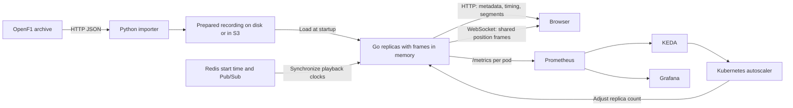

# F1 Race Replay technical guide

F1 Race Replay turns historical Formula 1 data into an interactive map. One viewer can seek independently. Shared viewers follow the same race time even when different servers handle their connections.

Read this in order. Follow one race frame to the browser, then follow one viewer through a pod failure. Finish by practicing the two résumé bullets aloud. The code links are there for a second pass.

## 1. Follow a frame from OpenF1 to the browser

### Python prepares the recording

OpenF1 returns timestamped JSON over HTTP. The importer fetches driver metadata, car coordinates, laps, running order and gaps, pit stops, tyres, race-control messages, and final results. It caches source responses on disk and retries transient request failures with backoff. It sets time zero from the race-start message, discards invalid coordinates, and sorts and deduplicates each driver's samples. [Full-grid importer](../../tools/import_barcelona_grid.py) · [Fetch, cleanup, and resampling](../../tools/import_barcelona.py)

A **frame** contains the available car positions at one instant. Raw observations arrive at uneven intervals, so Python builds one frame every **200 ms**. It uses an exact sample if available or interpolates between samples at most one second apart. Over longer gaps it omits the car, avoiding a potentially misleading path across the circuit. The file also holds track geometry, driver metadata, and separate timing records. Race order comes from the recorded standings because a lapped car can be physically ahead of the leader on the map.

Precomputing means Go can find a frame by dividing elapsed time by the frame interval. At 10 seconds, that gives frame 50. Each Go replica carries the cost of the decoded recording in memory. The full Barcelona recording has **28,135 frames for 22 drivers** and is about **24 MiB as plain JSON on disk**. Changing the preparation logic requires regenerating the file. [Frame lookup](../../replay.go)

### S3 stores the recording and Go serves it

**S3** stores named objects in buckets. The object here is the prepared JSON, optionally gzipped. With an `s3://bucket/key` path, Go uses the AWS SDK's `GetObject` to fetch the file. Go loads and validates the recording during startup and serves frames from memory thereafter. This keeps storage access off the playback path. Each new replica has to finish loading the recording before it can serve a viewer. [Server startup](../../main.go) · [S3 loader](../../s3.go)

**HTTP and WebSockets serve different viewer actions.** The browser fetches the page, metadata, and timing over HTTP. When you seek independently, it also uses HTTP to fetch a 20-second position segment and selects the frame inside it. Shared playback opens `/ws` with an HTTP upgrade. The connection stays open while the Go handler pushes position frames on the server's timeline. [HTTP routes](../../main.go) · [Personal seeking](../../web/analysis.js) · [WebSocket loop](../../stream.go)

The shared handler sends the current frame immediately, then schedules subsequent sends. Every message is a complete position snapshot, so joining late or reconnecting takes a single frame. A slow write has a two-second deadline, and a connection that falls behind can skip stale frames. Full snapshots cost more bandwidth than sending changes alone. Sending changes would require a way to give a reconnecting viewer a fresh starting snapshot. [WebSocket tests](../../stream_test.go)

**An improvement worth discussing.** Cold seeks had to download a whole plain JSON segment. Adding gzip cut the sampled segment sizes by about 77%. In a controlled local Chromium test at 1 Mbps and 40 ms latency, median cold seek went from **1.40 s to 0.38 s**. Versioned URLs let the browser cache segments and safely request a new URL when the underlying recording changes. A browser cache miss can reach Go, which already has the recording loaded. Compression adds CPU work to uncached requests. [Delivery change and measurements](https://github.com/auscodes/f1-race-replay/pull/19)

### Redis keeps replicas on the same timeline

Two Go processes may load identical frames and start 20 seconds apart. If each uses its own startup time, they're about 100 frames apart. **Redis stores one authoritative playback start time per recording version.** At startup, a Redis Lua script atomically initializes the start time if needed and returns it alongside Redis's current time. Each Go replica uses the difference to anchor its local monotonic clock, which measures elapsed time even if the host's wall clock changes. Frame selection and sending stay local to Go. [Shared clock implementation](../../replay_clock.go)

**Pub/Sub** sends a “clock changed” notification to currently connected subscribers. An operator reset updates the Redis key and publishes in one atomic operation. Replicas respond by reading the key. They also read it every two seconds to catch a missed notification. The key lets a replica joining later discover the current clock. Redis carries timing state and reset notifications. The recording stays in each Go process. [Cross-replica synchronization tests](../../replay_clock_test.go)

During a Redis interruption, an existing replica can keep playing from its last known start time. A new replica configured to use Redis needs it at startup. If Redis loses the epoch key, the next initialization can start a new timeline. The test cluster uses one Redis instance. [Local cluster manifests](../../deploy/local.yaml)

## 2. Follow a viewer through a pod failure

### Kubernetes provides capacity

**Docker** packages Go and the race file into a container image for the local test. **Kubernetes** runs copies as pods. A **Deployment** maintains the desired number of pods. A **Service** gives new connections one address and routes them to available pods. Existing WebSockets remain attached to the pods that accepted them. **kind** runs the Kubernetes cluster locally. **EKS** is AWS's managed Kubernetes service. [Container build](../../Dockerfile) · [Deployment and Service](../../deploy/local.yaml)

| Tool | How this project uses it |
| --- | --- |
| **Prometheus** | Periodically requests each pod's `/metrics` endpoint. The `f1_replay_websocket_connections` **gauge** rises when a socket opens and falls when its handler exits. Open sockets keep receiving frames, so concurrent connections are a useful measure of ongoing work. |
| **KEDA** | Gets the sum of the replay pods' open sockets from Prometheus and exposes it to the Kubernetes **Horizontal Pod Autoscaler (HPA)**. The HPA adjusts how many replicas run. |
| **Grafana** | Reads Prometheus to show total connections, connections by pod, and which pods respond to scrapes. It shows how the load moves after a pod disappears. |
| **k6** | Simulates 220 concurrent WebSocket viewers and checks frames and recovery from the client side. It measures interruptions that can happen between Prometheus scrapes. |

The policy targets **60 active sockets per replica**, with a minimum of two and maximum of four. At 220 open sockets, `ceil(220 / 60) = 4`. That explains the replica count the test drove. The 60-socket target is a test configuration. A capacity limit would require measuring CPU, network throughput, and uneven connection distribution under different loads. [Scaling policy](../../deploy/autoscale.yaml) · [Grafana dashboard](../../deploy/grafana/replay.json)

### k6 measures whether playback actually resumes

1. k6 opens WebSockets. The test driver waits until Prometheus sees at least 200 open sockets and Kubernetes reports four available replay pods, then deletes the serving pod with the most sockets.
2. An affected viewer detects a socket close or reaches the three-second watchdog for missing frames. It opens a new WebSocket. The Service can route it to a surviving pod while Kubernetes replaces the deleted one.
3. The new pod calculates the current frame from the shared clock. k6 times **the last valid frame before the interruption to the first correctly aligned frame after reconnect**. It estimates the expected sequence from elapsed time and allows up to one second of alignment jitter. An open socket alone would leave the playback position unverified. [Failure driver](../../load/verify-kubernetes.sh) · [k6 checks](../../load/recovery.js)

In the instrumented local run, Prometheus observed **220 concurrent connections**, replicas grew **from two to four**, and **all 118 interrupted viewers recovered within 10 seconds**. The slowest recovery was **1.090 s**. The test also completed all 220 sessions. These results describe one replay pod deletion with Redis and other replay pods still available. [Recorded run](https://github.com/auscodes/f1-race-replay/commit/fa1388e2dd3d5d2e807e74398fcaf120c5331ac7)

**An improvement worth discussing.** The first run missed the 10-second target for 30 of 114 interrupted viewers. A socket could stop sending frames before reporting a close, so we added a frame watchdog and bounded retries. A later run still had a 47.682-second outlier with an unconfirmed cause. We split k6's timing into detection, time before the successful retry, handshake, and frame alignment. In the instrumented run, the one-second retry wait accounted for most of the gap. That's a diagnosis of that run and gives us a way to investigate a future outlier. [Recovery test history](https://github.com/auscodes/f1-race-replay/blob/46f1227b455bc63a01b43520c36007c681becd63/docs/learning/scaling.md)

## 3. Defend the résumé bullets

| Suggested wording | What to say when asked how you verified it |
| --- | --- |
| Built a Go F1 replay service that loads S3-compatible recordings and streams telemetry over WebSockets, synchronizing playback across replicas with Redis Pub/Sub. | “The Go S3 SDK path was verified against **Moto**, a local S3 emulator. Two Go processes read the full recording and shared a real Redis clock. A late viewer joined at the current playhead on both servers, and an operator reset moved both back to the beginning.” |
| Autoscaled WebSocket servers on local Kubernetes with KEDA and Prometheus. Used k6 to test 220 concurrent connections and verified playback recovery within 10 seconds after deleting a serving pod. | “The **kind** test packaged the recording in the image. Four pods were available before the deletion. All 118 interrupted viewers received a correctly aligned frame in the instrumented run, with a maximum gap of 1.090 seconds. Production AWS verification would need a separate run on Amazon S3 and EKS.” |

Practice from a blank page. Draw **OpenF1 → Python → recording → Go → browser**, then add Redis next to Go and the **Prometheus → KEDA → HPA** loop. Explain why the recording is prepared ahead of time, what state Redis owns, and what the recovery timer measures. If asked what to improve next, start with the bottleneck you can measure. Per-replica memory and startup time would tell you when to consider loading chunks from storage. Recovery stage timings would tell you where to look after a slow reconnect.

[Run the viewer](../../README.md#quick-start) · [Try two Go replicas with Redis](../CONFIGURATION.md#shared-playback-across-servers) · [Reproduce the Kubernetes test](../DEPLOYMENT.md#run-the-load-and-recovery-test)
