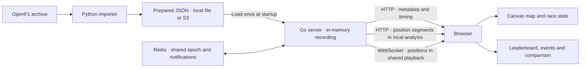
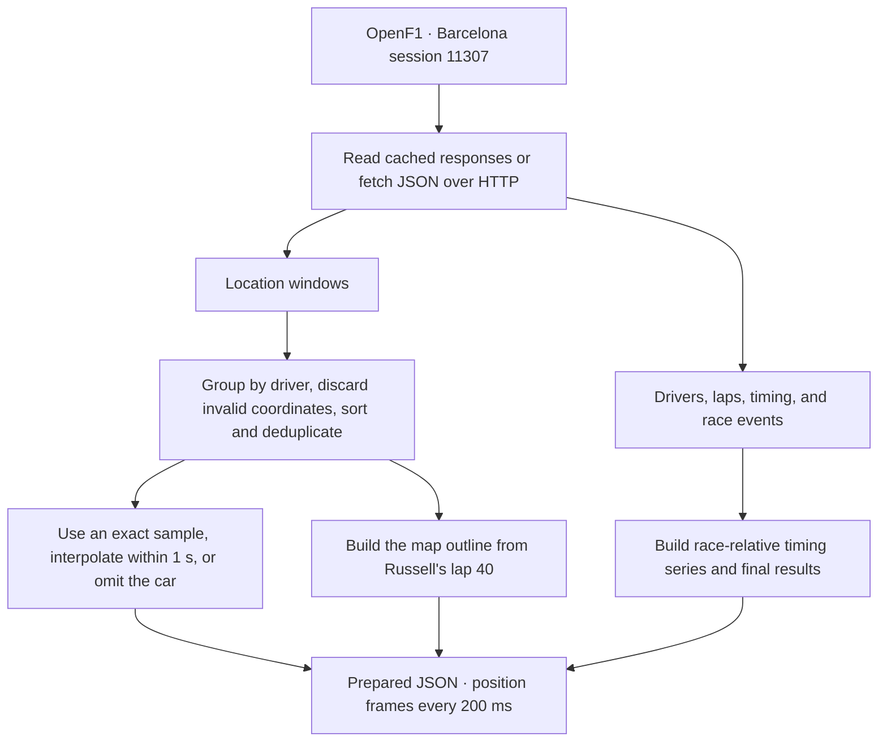
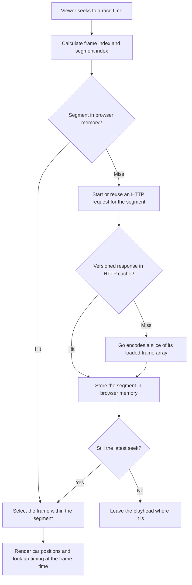
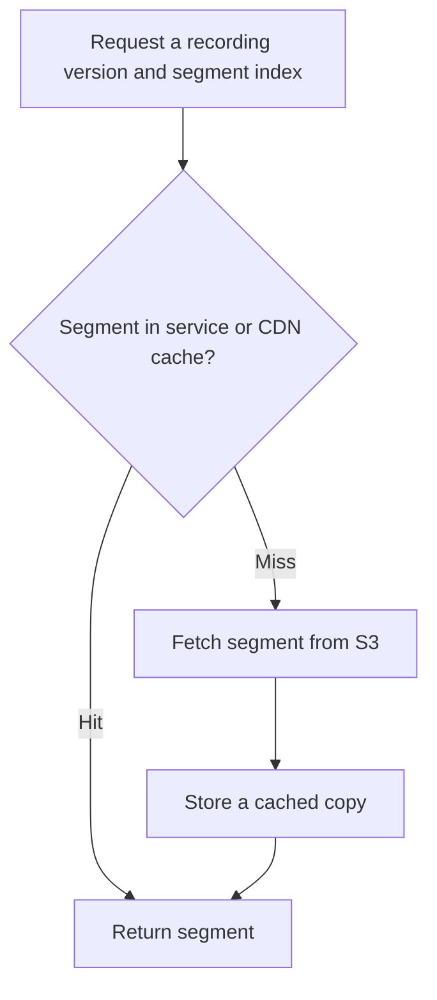

# F1 Race Replay architecture

## Overview

The interactive Barcelona replay covers all 22 drivers over about 94 minutes. Viewers can inspect a pit stop, follow a driver on the circuit, and compare lap times or gaps. Personal analysis has its own playhead. Shared playback follows a common clock across Go replicas when Redis is configured. Both modes use the same race timeline to align the map, standings, and race events.

## Data flow

The project began with a small synthetic recording served by a single Go process. The historical replay added a Python importer that pulls locations, lap timing, standings, tyres, and race control from OpenF1. It converts timestamps to milliseconds since lights out, samples car positions every 200 milliseconds, and saves the frames alongside the timing records.

Go loads the recording at startup from a local file or through the S3 SDK. The browser fetches the circuit, drivers, and session metadata over HTTP. In personal analysis it loads the 20-second segment that contains the requested moment. In shared playback Go pushes the current frame over a WebSocket. Both modes pass the same shape of frame to the renderer.

The browser draws car positions on Canvas and uses the frame timestamp to update the standings, driver comparison, and race-control banner. It loads detailed timing after the first map frame. With Redis configured, each Go replica calculates frames from the same shared start time and streams directly to its own viewers.

## Viewer workflows

### Investigate a race decision

Open Race events and select the first Virtual Safety Car deployment, about 55 minutes into Barcelona. The viewer jumps to the event and returns to the map. The leader’s lap, the positions of the cars, and the active VSC state all refer to that moment. Seek backward to see the field before deployment or choose Hamilton’s pit stop. Where the archive provides both, the event shows stationary time and pit lane time separately.

Compare Hamilton and Russell using their gaps to the leader and the last and fastest laps completed by the playhead. Changing either comparison driver keeps the playhead in place. The timing shows how their gaps changed around the stop. Traffic, tyres, and the VSC can all affect those gaps.

The browser loads the segment containing the selected frame. The map, standings, and race-control banner use that frame’s timestamp. On a backward seek before the deployment, the race-control lookup finds the earlier green state. [Local seek logic](../../web/analysis.js) · [Race-state lookup](../../web/race-context.js)

### Follow a driver through the full field

Select a driver from the standings, the driver picker, or the map. The viewer highlights the car and timing row and shows position, gap, lap, tyres, and last lap where available. The rest of the field stays visible. Switch between gap to the leader and interval to the car ahead to see overall race position in context or focus on an immediate battle.

Recorded timing determines race order. A lapped car can be physically ahead of the leader on the straight, so circuit coordinates alone give the wrong order. Timing and location also arrive at different rates. The viewer shows a dash when a gap sample is stale.

Each classified finisher gets a checkered flag at their own estimated crossing. Hamilton and Russell crossed about 19.5 seconds apart in Barcelona, and lapped finishers also get individual crossing times. The last frame shows the official classification. [Full-grid leaderboard](https://github.com/auscodes/f1-race-replay/pull/8) · [Map and driver selection](https://github.com/auscodes/f1-race-replay/pull/10)

### Review the same race moment together

Two viewers reviewing a pit stop need a common meaning for “look at that car now.” In shared playback, the second viewer can join halfway through and see the current moment. A viewer who reconnects also receives the current frame. Personal analysis keeps pause, speed, and seeking independent.

Try two shared tabs on one server. Start the second after the first has advanced. Then try the same recording on [two independently started servers](../CONFIGURATION.md#shared-playback-across-servers) with Redis configured. Each WebSocket has its own send loop, and both servers calculate the current frame from the shared epoch. [Shared send loop](../../stream.go) · [Late-join tests](../../stream_test.go) · [Reconnect test](../../tests/browser/replay.spec.mjs)

## Design changes during development

- **Two drivers to a full field.** Hamilton and Russell were the first historical slice. A full-grid view added recorded running order, gap and interval views, and a finish indicator for each classified finisher. [Full-grid change](https://github.com/auscodes/f1-race-replay/pull/8)
- **Driver navigation to race navigation.** The first lap picker followed Hamilton. The full-grid viewer uses race laps for navigation and puts event jumps in the event list. Driver selection stays independent of both and can be exercised with a driver farther down the field. [Map and navigation change](https://github.com/auscodes/f1-race-replay/pull/10)
- **Clip delivery to segmented playback.** The full-grid recording is about 24 MiB. In the original full-grid check, metadata and the first position block together were about 100 KB. The map can render while the detailed standings arrive. Segment size affects first-frame latency, cold-seek latency, and how many requests continuous playback makes. [Full-grid delivery change](https://github.com/auscodes/f1-race-replay/pull/8)

## Data and correctness

### What the importer downloads

The full-grid importer runs before the app starts. Python requests JSON from OpenF1 with the Barcelona session key `11307` and groups rows by driver number where applicable. Location data accounts for most of the rows, so the importer requests it in five-minute windows with one second of padding on each side for interpolation. Each request sequence starts with a 350 ms pause, uses a 35-second timeout per attempt, and backs off on transient failures. Successful responses are saved in `.recordings/openf1-grid` so an interrupted import can reuse them. The cache identifies location windows by index, so use a fresh `--cache-dir` when refreshing the archive or changing the session or window layout. [Full-grid import](../../tools/import_barcelona_grid.py) · [HTTP fetch helper](../../tools/import_barcelona.py)

| OpenF1 endpoint | What the replay extracts |
| --- | --- |
| `drivers` | Driver number, name, abbreviation, team, and team colour. |
| `location` | Timestamped X and Y coordinates for the cars and the reference lap. |
| `laps` | Lap starts and durations for lap navigation, completed laps, and finish estimates. The reference lap’s sector times mark approximate map boundaries. |
| `position` and `intervals` | Running order, gap to the leader, and interval to the car ahead. |
| `pit` and `stints` | Pit events and available stop or lane times, plus tyre compound, stint lap range, and starting tyre age. |
| `race_control` and `session_result` | Session start, selected flag and VSC transitions, and the final order, gaps, lap counts, and result statuses. |

### Recording format

OpenF1 observations arrive at irregular intervals. Python prepares position frames every 200 ms so Go can divide elapsed time by 200 and index directly into the frame array. At 10 seconds, playback selects frame 50. A 94-minute replay needs roughly 28,000 frames, each with the available coordinates for up to 22 cars. The prepared Barcelona file is about 24 MiB on disk. In memory, Go also holds the decoded recording. Precomputing saves the server from searching and interpolating raw observations whenever a viewer needs a frame. The trade-off is more stored data and a new import when the preparation logic changes. [Frame builder](../../tools/import_barcelona.py) · [Go frame selection](../../replay.go)

The JSON file holds session metadata, an array of position frames, and a timing history. A frame contains driver IDs and coordinates. Lap, tyre, gap, and race-control records stay in separate series because they change at their own rates. The browser uses the frame timestamp to find the applicable entries. This keeps unchanged tyre and flag data from being copied into thousands of frames and lets a backward seek reconstruct the earlier state.

### Timestamps and interpolation

The importer uses the `SESSION STARTED` message as time zero and converts source timestamps to elapsed milliseconds. It skips location rows with missing or non-finite X or Y values, sorts each driver’s usable observations by time, collapses identical duplicates, and rejects conflicting coordinates for the same driver and millisecond. Timing series are generally restricted to the replay window. Running order can carry the latest pre-start value into time zero to show the starting order. [Cleanup and time conversion](../../tools/import_barcelona.py)

When a sample lands exactly on a frame, the importer uses it directly. Between samples, it uses linear interpolation. If a car is at X=100 at 0 ms and X=140 at 400 ms, the 200 ms frame uses X=120. The surrounding samples must be at most one second apart. For a larger gap or a frame outside the observed range, the importer omits the car. A longer cutoff would keep more cars visible and could draw misleading paths across corners. The current cutoff is a design choice. If gaps regularly interrupt useful moments, compare how often cars disappear at different cutoffs and check the resulting paths against the circuit and the original observations. [Resampler](../../tools/import_barcelona.py) · [Importer tests](../../tools/test_import_barcelona.py)

### Race order and gaps

Track location shows where a driver is on the circuit. Someone who is a lap down can be physically ahead of the leader on the same straight. The timing tower uses recorded race order for rank, gap for the difference to the leader, and interval for the difference to the car ahead. It expires gap and interval samples after 15 seconds so stale numbers don’t sit on the board indefinitely. [Driver timing lookup](../../web/timing-tower.js)

### Race state at the playhead

Each view asks what was known at the selected timestamp. The race-state banner finds the last race-control transition. A Virtual Safety Car ending warning is its own state, and the track-wide clear message returns the race to green. For an individual checkered flag, the importer estimates the crossing from the driver’s final lap start and duration. The last frame shows the official classification, which can account for penalties. The archive has incomplete retirement timestamps, so those retirement labels appear with the final results.

For tyres, the browser finds the stint covering the driver’s current lap, then adds the laps run in that stint to the starting tyre age. For the lap comparison, it uses laps completed by the playhead. That means a backward seek can roll back a fastest-lap value or a finish flag. [Race state](../../web/race-context.js) · [Classification importer](../../tools/import_barcelona_grid.py) · [Lap comparison](../../web/race-review.js)

### Circuit map and driver selection

The importer uses Russell’s lap 40 for the outline and estimates the timing-sector boundaries by matching sector split times to nearby location samples. The browser uses the same coordinate projection for the track and the cars. When someone clicks the canvas, it compares the click with the projected car positions. The viewer holds one selected-driver ID, so the map, picker, and timing tower stay in sync. The sectors are approximate, and the map is meant to show race progress. [Circuit map](../../web/circuit-map.js) · [OpenF1 lap and location data](https://openf1.org/docs/#laps)

## Delivery, latency, and failure handling

### HTTP and WebSocket responsibilities

Both modes use HTTP for the page, metadata, and timing history. Personal analysis already knows which time it needs, so it requests that position segment directly over HTTP. Shared playback needs Go to push changing positions to all the viewers following its clock. A WebSocket starts with an HTTP upgrade and then stays open. Server-Sent Events could support the one-way stream too. A WebSocket also supports two-way messages if shared playback controls are added later. [Endpoint reference](../CONFIGURATION.md#interfaces) · [Routes](../../main.go) · [Shared stream](../../stream.go)

### A seek from event to frame

Selecting the first Virtual Safety Car deployment starts a seek. The browser gets the event time and rounds up to the first 200-millisecond frame at or after it. That works out to frame 16,676, in segment 166. The server sends that block with its starting frame index, so the browser can pick the right frame. The cars come from that position snapshot, and the banner looks up the last race-control transition at the frame time. Seeking back before deployment makes the same lookup return green. [Local seek logic](../../web/analysis.js) · [Frame rendering](../../web/viewer.js)

### Overlapping seeks

Each seek gets a generation number. After the network request completes, the browser checks whether that request is still the latest. An older response can populate the cache. Only the latest request can move the playhead. A targeted regression would return two segment requests out of order and check that the map and playhead still show the second seek. [Seek generation check](../../web/analysis.js)

### Segment size, caching, and failed requests

Twenty seconds is 100 frames at the recording’s 200-millisecond interval. The Go handler encodes an array slice and can gzip the response. The browser keeps up to five segments in memory per local analysis instance. Eviction follows insertion order. An in-flight request map lets overlapping requests for the same segment share one fetch. At 80% of the current segment, the browser starts fetching the next one when available. A seek into an in-memory segment skips HTTP. A miss goes through the HTTP cache and can reach Go, which already holds the recording in memory. The version in the URL lets browsers reuse the same segment across page loads. [Segment loader](../../web/analysis.js) · [HTTP handlers](../../main.go) · [Performance results](improvements.md)

Shorter segments would reduce bytes per cold seek and increase requests during continuous playback. Prefetch can spend bandwidth on a segment the viewer never reaches. A failed segment fetch pauses playback until the viewer seeks or presses Play. Full timing loads separately so the map can appear first. Go encodes that immutable timing payload once and keeps both plain and gzip versions for reuse. If timing fails to load, the map can continue with position frames. [Timing loader](../../web/viewer.js)

### Frame selection and loop boundaries

Go divides elapsed time since the playback clock’s start by the frame interval to get the sequence number. Taking it modulo the frame count gives the index inside the recording. The sequence keeps increasing across loops during the same shared clock run. An operator reset starts a new run and the sequence returns near zero. The browser uses the elapsed time within the recording to look up the right race state on each loop. [Frame lookup](../../replay.go) · [Shared clock](redis-clock.md)

### Late joins, disconnects, and slow viewers

On shared playback, each connection computes the current frame using the playback clock. Go sends that frame immediately on join. Each message contains a full snapshot, so a reconnecting viewer can draw the next message without reconstructing earlier frames. Each write has a two-second deadline. When a write succeeds but the loop has fallen behind, the next iteration recalculates the current frame and can skip old ones. The design keeps viewers close to the shared playhead at the cost of repeated coordinates and per-connection encoding. If encoding shows up in a profile, replicas could reuse an encoded payload for viewers on the same frame. Delta messages would also need a way to send a fresh baseline after reconnect. [Shared stream](../../stream.go)

### Object storage and startup

S3 is optional storage for the prepared JSON. Go reads and validates the whole recording at startup, then serves frames from process memory. Every replica pays the startup and memory costs. The SDK path was exercised separately using Moto, a local S3 emulator, with two Go processes and real Redis. The local Kubernetes test image packages the recording. [Startup and routes](../../main.go) · [S3 loader](../../s3.go)

For a larger catalog, a possible design is to store independently retrievable segments in S3. A service or CDN could serve a segment from a cache keyed by recording version and segment index, and fetch it from S3 on a miss. Popular highlights could become hot entries through normal requests. That would reduce how much each replica loads and keep repeat lookups fast. A cold seek would pay storage latency. The full race would still take space in S3. Compression or a lower frame rate addresses recording size. Measure memory per replica, startup time, and cold-seek latency before changing the storage layout.

## Testing strategy

The importer tests check interpolation, missing samples, timing boundaries, and a lapped driver finishing on their own crossing. The Go tests check frame selection and wraparound, file and S3 reads, segment bounds, and whether a WebSocket late join receives the current frame. The browser tests check visible behavior, including seeking back through a VSC, swapping comparison drivers, and reconnecting. GitHub Actions runs all three layers. Manual checks covered the real Barcelona recording on desktop and mobile, including map selection and race-event jumps. [Importer tests](../../tools/test_import_barcelona_grid.py) · [Go replay tests](../../replay_test.go) · [Stream tests](../../stream_test.go) · [Browser tests](../../tests/browser) · [CI](../../.github/workflows/ci.yml)

## Scaling and reliability

### Clock coordination across replicas

Two servers can load the same recording and show different moments. The recording tells you which frames exist. In local-clock mode each process uses its own start time. Redis mode stores one shared start time keyed by a hash of the recording. Both replicas map the shared reference onto their own monotonic clock and compute frames locally. Pub/Sub announces a clock reset, and a periodic read repairs missed notifications. The integration test connects viewers to two servers, checks their frame indices, and verifies that both existing sockets adopt an operator reset. [Redis architecture](redis-clock.md)

### Redis outages and shared controls

With watch-only playback and an immutable start time, a replica that already has the reference can continue using it. A newly started replica needs the reference before it can promise a synchronized replay. Clock skew remains a consideration because replicas advance from their own local time samples. Adding shared pause or seek would require versioned playback state with a playhead anchor and playback status, rules for who can issue changes, and agreement on the order in which replicas apply them.

### Estimating playback capacity

At five frames per second, 200 viewers means roughly 1,000 outbound frame messages per second at full cadence. Multiply that rate by the average bytes per message to estimate bandwidth. A capacity test can then measure CPU, memory, reconnect behavior, and viewer drift to choose a target with enough headroom. Personal analysis uses versioned HTTP segments today. A CDN could serve those same immutable segments to multiple viewers and reduce requests reaching Go. [Local analysis delivery](#segment-size-caching-and-failed-requests)

### Autoscaling and observability

Kubernetes runs the Go replicas and sends new connections to available pods through a Service. The Go handler keeps a gauge of open WebSockets. Prometheus scrapes it per pod and KEDA exposes the total to the Kubernetes autoscaler, with a per-replica target. Grafana queries Prometheus to show total and per-pod connections and which pods are responding to scrapes. k6 acts as the audience. In the verified local run it held 220 WebSockets open, KEDA scaled from two pods to four, and all 129 viewers on the deleted pod resumed on a correctly aligned frame. The longest gap between valid frames was 1.208 seconds. Redis is what gives a surviving pod the reference it needs to serve that same race moment. [Scaling design](scaling.md#how-scaling-and-recovery-work)

### How the failure test changed reconnect behavior

A socket can stop delivering frames before the client sees a close event. The viewer uses a three-second watchdog and reconnects when the stream goes silent. The k6 test checks frame alignment after reconnection and now breaks the gap into detection, retry, handshake, and alignment. The failure test and subsequent reruns show why the total time alone is insufficient for diagnosing a slow recovery. [Failure experiment](scaling.md#what-the-first-load-test-changed) · [Reconnect measurements](improvements.md#one-recovery-number-hid-where-the-time-went)

## Code map

| Topic | Entry points |
| --- | --- |
| Where historical data becomes a replay | `import_grid` and `resample`. [Importer](../../tools/import_barcelona_grid.py) · [Resampler](../../tools/import_barcelona.py) |
| How the server knows which frame to send | `replayRoutes`, `frameAt`, and `frameStream.serve`. [Routes](../../main.go) · [Frame lookup](../../replay.go) · [Stream](../../stream.go) |
| How a seek reaches the screen | `startAnalysis` and `showFrame`. [Analysis](../../web/analysis.js) · [Viewer](../../web/viewer.js) |
| How the map and leaderboard stay aligned | `setupCircuitMap`, `latestAt`, and `driverSnapshot`. [Map](../../web/circuit-map.js) · [Race state](../../web/race-context.js) · [Timing](../../web/timing-tower.js) |
| How replicas agree on the clock | `redisReplayClock.refresh` and `redisReplayClock.watch`. [Redis clock](../../replay_clock.go) |
| How the cluster scales and proves recovery | Follow the [autoscaling policy](../../deploy/autoscale.yaml), [Grafana dashboard definition](../../deploy/grafana/replay.json), and [k6 scenario](../../load/recovery.js). |
