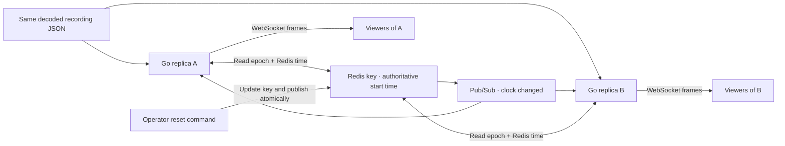
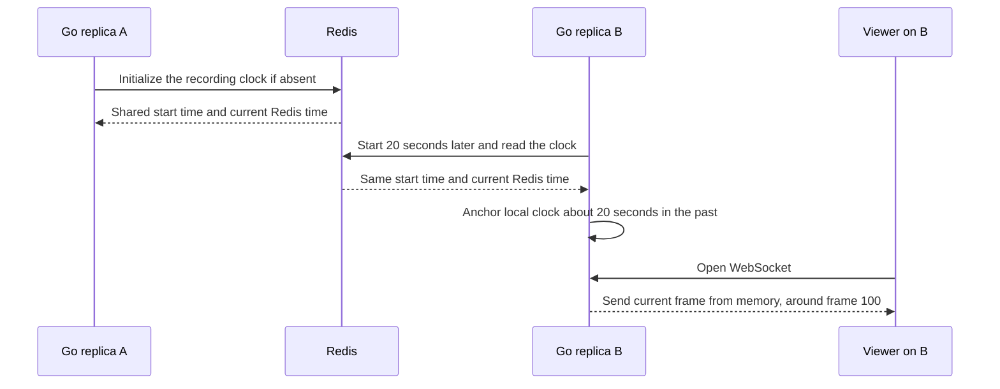

# Redis shared playback clock

New to Redis or WebSockets? Start with [how a race frame gets to the browser](stack.md#how-a-race-frame-gets-to-the-browser).

## Clock ownership

Two Go processes can load the same recording and still show different frames if they start at different times. Redis gives replicas a common start time. The key is scoped to a recording hash, so replicas only share a clock when they agree on what to play. Each server reads the Redis start time and the current Redis time together, then maps that elapsed time onto its own monotonic clock. That gives it a cheap local calculation for every frame.

The Redis key holds the authoritative epoch. Pub/Sub tells running replicas when it changes, such as after an operator resets the replay. On a notification, a replica reads the key again. Since Pub/Sub delivers messages only to connected subscribers, the server also rechecks the key periodically to repair a missed update. Redis carries clock changes. Go still streams the actual telemetry frames over WebSockets.

Suppose server A initializes the clock and server B starts 20 seconds later. B reads the stored start time and Redis’s current time in one Lua script call. The difference is about 20 seconds, so B anchors its local clock about 20 seconds in the past and can immediately serve around frame 100 at the 200 ms cadence. From there, each Go process uses its local monotonic clock, a timer that measures elapsed time even if the machine’s wall clock is adjusted. Normal frame delivery does an in-memory lookup. The browser’s segment cache belongs to personal analysis and has a separate purpose. [Clock synchronization](../../replay_clock.go) · [Browser segment cache](architecture.md#segment-size-caching-and-failed-requests)

## Data and control flow





| Decision | Reason and trade-off |
| --- | --- |
| **Atomic initialization and reset** | A Redis Lua script initializes a missing epoch or replaces it during an explicit reset. The script also publishes the notification. Concurrent starting replicas read the same value, and a subscriber can read the updated key after receiving the notification. |
| **Redis time as a reference** | Sampling Redis time with the epoch avoids depending on the Go hosts having identical wall clocks at startup. The midpoint of the round trip estimates when Redis took the sample. Network asymmetry and clock drift leave some residual skew. |
| **Monotonic local clock per replica** | Each connection reads the same local start time through an atomic pointer. A normal frame needs a timer and an array lookup. The clock is re-anchored only when the Redis epoch changes. |
| **Key plus Pub/Sub** | The key gives late joiners and new replicas a source of truth. Notifications let already-running replicas react promptly. A two-second reconciliation interval bounds how long a missed notification normally takes to catch up after Redis is available. |
| **Keep the last clock during a Redis outage** | Running replicas can continue playing from the last known epoch. A configured replica that cannot read Redis at startup fails startup. If Redis loses the epoch key, the next successful read creates a new timeline. Redis persistence determines whether the epoch survives a Redis restart. |

[Implementation](../../replay_clock.go) · [WebSocket loop](../../stream.go) · [Redis delivery semantics](https://redis.io/docs/latest/develop/pubsub/#delivery-semantics)

The two-second check repairs missed resets. Go leaves its local anchor alone when the Redis start time is unchanged, so clock drift or uneven network delays can still introduce small differences across replicas. If tighter alignment becomes a requirement, measure viewer drift over long runs before choosing when to resynchronize. The local cluster has one Redis instance. A new replay replica depends on Redis at startup, and loss of the clock key can establish a new timeline. Testing Redis failover and preserving the epoch across restarts would matter before treating the system as highly available. [Local cluster manifests](../../deploy/local.yaml)

## Verify locally

With a Redis instance running, start two Go servers with the same `REPLAY_REDIS_URL` and the same file or bundled demo. Start the second a few seconds later and open shared playback on both. A reset through `-reset-shared-clock` should move both existing connections back to the beginning.

The Redis integration tests start two HTTP servers with distinct client connections. They compare WebSocket frame indices on late join, use an operator reset to prove Pub/Sub propagation to existing connections, and simulate a lost notification to verify reconciliation. Run the same tests with:

```sh
REPLAY_TEST_REDIS_URL=redis://127.0.0.1:6379/0 go test -race ./...
```

[Run instructions](../CONFIGURATION.md#shared-playback-across-servers) · [Redis integration tests](../../replay_clock_test.go) · [All milestones](milestones.md)
