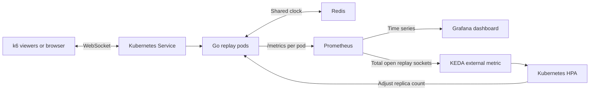

# Scaling and recovery

## How scaling and recovery work

The Go WebSocket handler counts open connections. Prometheus scrapes each pod, KEDA exposes the total as an external metric, and Kubernetes’ Horizontal Pod Autoscaler (HPA) adjusts the Deployment. The local policy keeps two pods available and targets an average of 60 open sockets per pod, up to four pods. A new pod can accept new or reconnecting viewers. Existing sockets stay on the pods that accepted them.

When a serving pod goes away, clients reconnect through the Service. The new server computes the current frame from the same Redis clock. The browser retries after a close or after three seconds without a frame. The load test measures from the last valid frame to the first correctly aligned frame after reconnect. It includes time spent detecting the disconnect. A surviving pod can restore playback while Kubernetes is still replacing the failed pod.

## Delivery and control flow

| Choice | Why |
| --- | --- |
| **Gauge per pod** | Counts concurrent work and falls on disconnect. Prometheus discovers each pod and includes its name in the target label. Scraping one load-balanced Service address could miss pods and miscount the total. |
| **Total connections with an average target** | Prometheus returns a single value. KEDA and the HPA turn the total into a target number of pods. The local target is a scale-test setting. A production threshold would come from frame sizes, CPU, latency, and headroom under load. |
| **Two-pod floor and delayed scale-down** | The minimum replica count gives viewers another pod to reconnect to after one pod fails. Scale-down stabilization reduces churn during short reconnect waves. Scale-up increases capacity for new connections. |
| **One Redis clock and recording** | A replacement pod can load the same recording and resolve the playhead at startup. The readiness endpoint is reachable after recording and Redis clock initialization. |
| **k6 run paired with pod deletion** | The driver waits for Prometheus to observe at least 200 concurrent connections and Kubernetes to report four available pods. It then deletes a pod with live viewers. The run must observe at least as many successful recoveries as the deleted pod’s connection count at the pre-deletion scrape. k6 requires each interruption to recover within 10 seconds and checks that the first recovered frame matches the expected sequence within one second of timing jitter. |

[KEDA Prometheus scaler](https://keda.sh/docs/2.21/scalers/prometheus/) · [k6 WebSockets](https://grafana.com/docs/k6/latest/javascript-api/k6-websockets/) · [Redis clock](redis-clock.md)

## How Grafana is provisioned

Grafana reads metrics from Prometheus. KEDA queries Prometheus separately to scale the Deployment. Kustomize turns the dashboard and data source definitions into ConfigMaps. When a file changes, Kustomize generates a new ConfigMap name, so applying the manifests updates the pod template and restarts Grafana with the new configuration. [Grafana configuration](../../deploy/grafana)

## What the first load test changed

The initial run reached 220 connected viewers and four available pods. After the pod deletion, 84 of 114 interrupted viewers recovered within 10 seconds. The longest observed gap was 60.6 seconds. The distribution of handshake times pointed to stalled reconnect attempts. We added a three-second frame watchdog to the viewer and a bounded retry cadence to the k6 client. A Playwright test covers an open socket that stops delivering frames. Three seconds allows roughly 15 expected frames to go missing before reconnecting. A shorter timeout would react faster at the cost of extra reconnects during temporary network stalls.

## Verified local run

This recorded passing run used the full Barcelona recording on a local kind cluster with Kubernetes 1.36.4, KEDA 2.21.0, Prometheus 3.16.0, Redis 7.4.12, and k6 2.1.0.

| Measurement | Result |
| --- | --- |
| Concurrent WebSockets observed by Prometheus | 220 |
| Available replay pods before disruption | Scaled from 2 to 4 |
| Connections on the deleted serving pod | 129 |
| Disrupted viewers receiving an aligned frame within 10 seconds | 129 of 129 |
| Recovery gap, measured from last good frame to first aligned frame | 1.207 seconds at p95, 1.208 seconds maximum |
| Completed k6 iterations | 220 of 220 |
| Valid frame messages scored by k6 | 98,442 of 98,442 |

The load driver completed successfully. The result applies to one deleted app pod on local Kubernetes, with Redis and surviving app pods still available.

## Grafana verification runs

Both reruns with Grafana installed reached 220 concurrent WebSockets, grew from two to four available replicas, and finished all 220 k6 iterations. The driver deleted a pod with 118 connections each time. k6 counts interruptions across every viewer, so that total can exceed the pre-deletion connection count.

| Run | Interruptions recovered within 10 seconds | Longest gap | Result |
| --- | --- | --- | --- |
| First rerun | 124 of 134 | 47.682 s | Recovery threshold failed |
| Repeat | 118 of 118 | 1.102 s | All thresholds passed |

The dashboard [screenshot](../images/grafana.png) is from the passing repeat. The driver requested pod deletion at 16:49:30 UTC. The per-pod chart shows the deleted pod’s series ending and surviving pods accepting its viewers. The cause of the slower first rerun remains unconfirmed. The results show that recovery can vary even when the deployment reaches the same connection and replica counts.

[Run the experiment](../DEPLOYMENT.md#run-the-load-and-recovery-test) · [Open Grafana](../DEPLOYMENT.md#view-the-grafana-dashboard)
